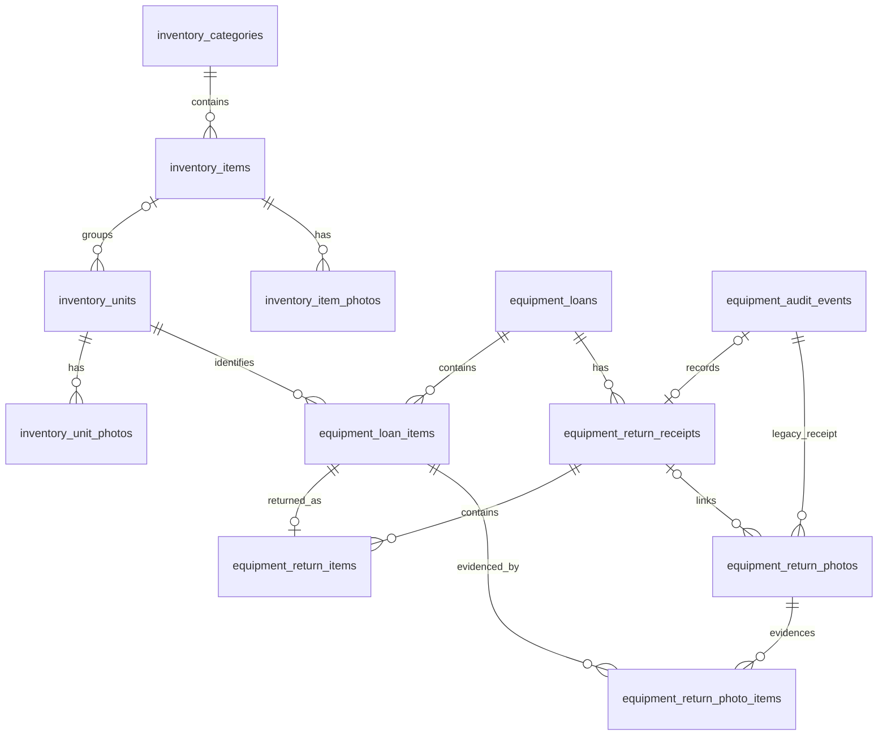

# Phase 6C.4J | Equipment database restructuring

## Status PARTIAL

The additive migration, normalized models, transactional backfill service, and compatibility writes are present in the working tree. No DDL or backfill ran on either database. The persisted testing demo still has an active ledger with IDs and per-row hashes. Running backfill would invalidate ownership verification for its 51 units and three return photos. This phase preserves those records and their ledger.

## Schema and relationships

Migration `2026_11_21_000001_expand_equipment_inventory_and_returns` adds four tables and nullable references. The target after applying it is 43 tables and 25 recorded migrations. Existing IDs, columns, unique keys, FK references, and the generated active unit constraint are retained. Unit codes and loan snapshots remain intact. The new return detail enforces unique loan item and a condition CHECK. Photo revisions are unique per item, with a MIME and size CHECK. Actor FKs use unsigned INT. Historical record FKs restrict deletion.

## Read-only preflight

| Database | Tables | Migrations | Units | Grouped children | Planned items | Loan items | Candidate returns | Media matched |
| --- | ---: | ---: | ---: | ---: | ---: | ---: | ---: | ---: |
| wpitv | 39 | 24 | 57 | 46 | 11 | 10 | 3 | 14 |
| wpitv_testing | 39 | 24 | 51 | 41 | 10 | 10 | 3 | 13 |

Both databases were identified on the local server and the testing runner's DML-only grants verified. Neither database has nested memberships. The named SQL dump was unavailable at the checked Downloads location. The live counts and fresh dumps were used for this phase.

The deterministic migration maps each verified old parent ID to the same numeric item ID in the new table. Singletons map to their own item ID. The parent record remains the original physical unit. All units in a group receive the same item ID. The backfill returns a mapping summary for the operator to store privately. It rejects nested, conflicting or missing parents and leaves ambiguous audit returns for review. Each return detail requires a match on loan, unit, time, condition and notes. Return photos retain the old audit FK and gain a receipt FK. Existing item covers remain accessible via the legacy unit photo route. New item photos reuse validated private files with separate metadata, and historical files remain in place.

## Private backup

Folder `%LOCALAPPDATA%/WPiTV-Backups/equipment-6c4j-20261121-060158-b4e840`. Verified SQL footer, encoding, table and per-table row counts, SHA-256 and fingerprint consistency during backup. Media were copied separately and verified against DB hashes. Restore of this backup remains untested.

| Database | SQL rows | Media | SQL SHA-256 |
| --- | ---: | ---: | --- |
| wpitv | 36709 | 14 | d72abdd55a81fee23875561372ee19aaf19905f65c501a6425d5cab57b7324cc |
| wpitv_testing | 298 | 13 | a48ec038c02aa3bbcaa87ab4955814f6f15136a6bdcc191db5eb07acd31ba64e |

## Compatibility and verification

Item metadata and the numbering counter are written from the existing inventory form and stock transaction when the expanded schema is available. The return service creates a normalized receipt and details in the same transaction as the audit event, unit status and evidence. Existing return replay continues to use the immutable audit record. POS and stock readers still use the legacy grouping during this expansion step. The new item ID remains nullable pending cutover and verification of every writer.

The legacy-schema Equipment suite passed 142 tests with 729 assertions, including its two-connection cases. PHP lint, Pint, Blade compilation, Vite build and seven JavaScript tests passed. Vite emitted the existing PostCSS warning. Expanded-schema DDL, integration, concurrency, rollback and repeated historical backfill have yet to be exercised.

## Gates before rollout

1. Preserve or reconcile the active testing demo ledger through a separate approved procedure. Use a verified isolated copy if the live demo must remain usable during testing.
2. Verify backup recency and quiet writers. Apply the reviewed DDL only to testing using its separate provisioning connection. Record the migration and update the isolated schema approval with the actual SHOW CREATE signature.
3. Run the backfill twice and persist the mapping, unmatched IDs and media verification in a private ledger. Compare fingerprints excluding only the approved additive columns and tables.
4. Complete POS master reads and fallback, inventory photo routing, all mutation paths and test cleanup for normalized foreign keys. Test lock ordering, replay, failure rollback, RBAC and historical IDs against the expanded schema.
5. Make item IDs mandatory only after verifying all write paths and zero orphans. Review rollout to wpitv separately.

### Candidate file hashes

| File | SHA-256 |
| --- | --- |
| database/migrations/2026_11_21_000001_expand_equipment_inventory_and_returns.php | a741b26919ba55467216dd204f7efb051919e8611723ac1d1ebe9c6aea969119 |
| app/Models/InventoryItem.php | 986464081fc83eadab3150ef98d05d31e0af49715e9a95039c6aadd5f0e2ec58 |
| app/Models/InventoryUnit.php | 100d417f42394b515e0e8a14f06f71c01b009b528b51ac24512d4aea0f234313 |
| app/Services/EquipmentStructure.php | 01e7f26040cff073a579781e1f1ac1193bf7800aaaf96a3ec0a84ee6ed0df75f |
| app/Services/EquipmentStructureBackfill.php | 1cc6b7d338845cd6d13874c2b4e80df6a04bdb3ffc0cc08b8fcf0133b73c21f4 |
| app/Services/EquipmentQuantity.php | 961eb35c38e221ab697a1770836f736e800d4326fc612abbd0fcf1636d6a2ca3 |
| app/Services/EquipmentLoanReturn.php | 371d505d3e37266a600e075e71d7956373705a3ce74188a2224ba4c409922daf |
| app/Livewire/Admin/Inventory/Units/Form.php | 1d5e8bea8ccbe8fd38f8110cc03b34b436cfa784837f454e7a5bcc7a15b5abcc |

### Phase 6C.4J.1 | Validasi clone MySQL terisolasi

Verdict **PARTIAL**. Restore dan backfill tervalidasi pada clone. Suite Feature/RBAC Livewire lengkap masih menunggu harness yang menerima hostname dan nama database clone tanpa melemahkan guard. Akun fixture dan ledger pada kedua database sumber tetap utuh.

- Backup `wpitv_testing.sql` dari 6C.4J diimpor ke `wpitv_6c4j_validation` melalui instance MySQL terpisah. Instance memiliki datadir, port loopback dan UUID sendiri. Loader dibatasi pada database kosong itu. Akun validation_runner hanya memiliki SELECT/INSERT/UPDATE/DELETE. Proses disposable dihentikan setelah validasi.
- Operator memeriksa SHA-256 dump dan menolak instruksi pengalihan database. Salinan untuk impor menyisihkan perintah DROP TABLE IF EXISTS. Dump asli tetap utuh. Hasil restore 39 tabel, 24 migration dan 298 baris cocok dengan fingerprint data, encoding kolom dan DDL setelah normalisasi AUTO_INCREMENT serta deklarasi charset ekuivalen. Restore backup `wpitv` utama tidak diuji.
- Sebanyak 13 media disalin ke disk privat clone dan dicocokkan dengan hash. Bukti gambar dari checkout validasi dapat dibuka petugas dan ditolak saat menggunakan ID item lain.
- Migration menghasilkan **43 tabel dan 25 migration**. Signature SHOW CREATE setelah normalisasi ialah `0fffa07ba446ac1b32c9a43b9d35d7edca8de757c6ad502e9d4a3bf3e6ae0885`. UNIQUE active_unit_id dan CHECK kondisi retur terverifikasi.
- Backfill pertama menghasilkan 10 barang untuk 51 unit, 3 receipt dan 3 detail retur. Tidak ditemukan mapping ambigu, unit tanpa item atau retur tak terpetakan. Backfill kedua identik dengan pertama. Klasifikasi stok per kelompok, ID, snapshot transaksi dan hash kolom historis cocok setelah mengabaikan kolom additive yang diotorisasi.
- Dry-run ledger mengidentifikasi perubahan pada 51 baris unit dan 3 baris metadata bukti. Mapping privat tersimpan di berkas `validation-6c4j-*.json` di folder backup. Fingerprint sumber dan SHA-256 ledger asli tetap cocok sebelum dan sesudah pengujian. Jangan menjalankan cleanup lama terhadap database hasil backfill.
- Pembacaan katalog menggunakan identitas master ketika relasi item tersedia. Daftar unit, agregasi stok POS dan alokasi membaca item_id, dengan fallback pengelompokan lama. Snapshot baru mengambil identitas master dan mempertahankan kode unit fisik. Foto cover baru memakai metadata barang dan policy existing. Detail transaksi menampilkan kode receipt normalisasi dengan histori legacy tetap tersedia.
- Probe clone lulus **31 assertion** mencakup stok, role empat akun, checkout lintas barang, beberapa unit, replay, penolakan checkout ulang pada unit sibuk, stale version, rollback audit, retur baik/rusak dan parsial/penuh, akses bukti, dan race dua proses PHP dengan tepat satu commit. Suite Unit lulus **464 tes / 2.162 assertion**, JavaScript **7 tes**. PHP lint, Pint, kompilasi Blade, Vite dan diff check lulus. Vite memberi peringatan PostCSS yang sudah ada.

Gate berikutnya mencakup rekonsiliasi ledger untuk testing asli, lalu regresi Feature/Livewire end-to-end skema baru pada harness clone termasuk pemilihan manual, konflik versi lewat form, dan cleanup fixture normalisasi. item_id tetap nullable sepanjang masa transisi.

| Berkas terkait pembacaan | SHA-256 |
| --- | --- |
| app/Services/EquipmentStock.php | f7d9b795ba282988ed3899a7e8655c6f7ecd99c1e118a84d6308c3ed9a01f8f0 |
| app/Services/EquipmentQuantity.php | 653f4992f7596f5b80b52ade702d28b3969a2558ea7c5f348e08266b457d2e25 |
| app/Services/EquipmentLoanCheckout.php | dff6ff311a54776a4389d2d71afb5fc2d69ea8543c2f265252ef79a88f2717f2 |
| app/Http/Controllers/EquipmentPhotoController.php | 26389523daa3cf0d41dd7ca4151ee39efc47d67aa76a38462c115892db5218d9 |
| app/Livewire/Admin/Inventory/Units/Show.php | 40bda8f27adf5b270c98d7b8c87c8176939e5695b0f5dc7d2720fa9778b40e9d |
| app/Livewire/Admin/EquipmentLoans/Show.php | 4bd21ef1f316c7eb2945a61130648ba1354929fd3a14f131e5d32e021419f169 |
| resources/views/livewire/admin/inventory/units/show.blade.php | 1cfe181cae3aa0f4e0121498241755eb232d0380f3605a39f1c01adf2e726dbf |
| resources/views/livewire/admin/equipment-loans/show.blade.php | 385f9773dd26e446474e7fd690b528250b0c04db05f8d3135b449110e1013ef2 |
### Phase 6C.4J.2 | Regresi skema expanded dan rekonsiliasi ledger

**READY FOR TESTING ROLLOUT.** Gate validasi clone lulus. Penerapan pada testing asli dan penerbitan ledger baru merupakan operasi terpisah.

#### Regresi aplikasi

Clone `wpitv_6c4j_validation_testing` dipulihkan dari dump 298 baris serta 13 media. Instance memakai UUID, port loopback, datadir, runtime Laravel dan penyimpanan privat tersendiri. Koneksi provisioning dibatasi pada clone. Suite berjalan dengan runner DML-only. Salinan test harness mempertahankan pemeriksaan identitas sesi, izin dan signature skema serta mengikatnya ke UUID instance disposable. Guard dan konfigurasi database sumber tetap berlaku. Perbaikan salinan vendor menyertakan direktori Cache framework agar bootstrap dapat dimuat.

Migration menghasilkan 43 tabel dan 25 migration. Backfill dua kali memberi pemetaan identik untuk 51 unit, 10 barang, 3 receipt dan 3 detail retur. Signature skema cocok dengan 6C.4J.1. Fingerprint kolom historis cocok setelah mengecualikan kolom tambahan yang telah diotorisasi.

| Pemeriksaan | Hasil |
| --- | --- |
| Equipment Feature/Livewire dan konkurensi | 31 tes, 407 assertion. Termasuk 10 tes pada kelas konkurensi dua koneksi |
| Unit penuh | 464 tes, 2.162 assertion |
| JavaScript | 7 tes lulus |
| PHP lint, Pint, Blade, Vite dan diff check | Lulus. Vite memberi peringatan PostCSS yang sudah ada |

Regresi mencakup kategori dan unit, stok, checkout otomatis dan manual, retur parsial dan penuh, kondisi rusak, retry, rollback, dashboard, empat role serta akses media privat. Assertion tambahan memeriksa hubungan unit dengan master, foto barang dan penolakan IDOR pada route foto, serta relasi receipt/detail/foto hasil retur. Perbaikan cover menggunakan foto master yang sama untuk unit turunan tanpa foto sendiri. Cleanup suite kini menghapus receipt, detail retur dan master hasil fixture sesuai urutan FK. Fingerprint clone kembali cocok setelah semua fixture suite dibersihkan.

#### Ledger versi 2 dan dry-run

Rekonsiliasi memeriksa ID dan hash setiap preimage terhadap ledger asli. Khusus unit dan metadata bukti, preimage dihitung dengan mengecualikan kolom additive yang diizinkan. Pemetaan item, kolom pensiun, dan tautan receipt diverifikasi tersendiri. Laporan versi 2 mencatat ID, hash sebelum/sesudah, baris di luar ledger, ID yang hilang, konflik, serta hash baris turunan yang kepemilikannya dibuktikan dari kelompok dan audit asal. Perubahan nama unit pada clone ditolak. Unit luar ledger yang merujuk item milik paket juga memblokir cleanup.

Simulasi memakai postimage hash dan memeriksa semua FK masuk, menghapus berdasarkan ID dalam satu transaksi, lalu rollback. Cakupan mencakup 51 unit, 10 item master, 5 pinjaman, 3 receipt, 3 detail retur, 71 event audit dan dependensinya. Hash baris dan signature skema cocok setelah rollback. Penghitung AUTO_INCREMENT dinormalisasi karena MySQL dapat menaikkannya pada insert yang di-rollback. Laporan privat berada di `ledger-dryrun-*.json` di folder backup 6C.4J. SHA-256 ledger asli tetap `1aff97db8ac13b883935223c07595c0d1b039a1db0cae5c7b337677f9b740dea`. Fingerprint `wpitv` dan `wpitv_testing` cocok sebelum dan sesudah.

#### Restore drill utama

Dump `wpitv.sql` 6C.4J dipulihkan pada database terpisah `wpitv_6c4j_primary_restore`. Verifikasi cocok untuk 39 tabel, 24 migration dan 36.709 baris. Seluruh 65 FK diperiksa tanpa orphan, dan 14 media salinan cocok dengan metadata dan SHA-256. Clone utama digunakan untuk restore saja. Kedua proses MySQL disposable dihentikan.

#### Gate penerapan

Sebelum testing asli menerima DDL, hentikan penulis Equipment, ulangi fingerprint dan backup, serta validasi hash ledger asli terhadap snapshot terbaru. Sesudah backfill, cocokkan laporan versi 2 dengan preimage dan hasil dry-run. Publikasikan ledger pengganti serta signature testing melalui approval terpisah. Cleanup lama harus tetap ditahan selama ledger lama masih aktif. Pengujian fase ini tidak menerapkan DDL pada kedua database asli.

### Phase 6C.4J.3 | AWAITING APPROVAL

Gerbang persetujuan belum dibuka. Pemeriksaan fase ini bersifat read-only pada database, ledger dan media aktif. Kedua database memiliki 39 tabel dan 24 entri migration. Target yang ditinjau adalah `wpitv_testing`, dengan 51 unit, 10 kelompok yang dapat dipetakan, dan tiga kandidat receipt yang cocok dengan histori. Seluruh bukti media cocok dengan metadata. Runner testing terverifikasi DML-only.

| Database | SHA-256 skema | Fingerprint isi |
| --- | --- | --- |
| wpitv | 0abe089e7087b0e805d367a13fc428817d7ea834b5f6f418ba3d56e3c844c430 | da8ef65b157a410e53d9da068faa3a497bb1d18868e02ff224a237fb50517444 |
| wpitv_testing | eb3daa05deb6c098822c6bdb2498b1a5dd7b6f911b352809a1af9cea5d7a8e27 | 58a46404516fd6cb360b0f5203a2e7bab45b32e7571e809fdcc4c8e13b388ce1 |

Ledger aktif versi lama cocok dengan hash 6C.4J.2. Belum ada ledger pengganti yang dipublikasikan. Dump dan salinan media cadangan 6C.4J dicocokkan ulang dengan manifest privat. Keduanya pernah dipulihkan pada instance terpisah, dengan 298 baris dan 13 media untuk testing serta 36.709 baris dan 14 media untuk utama. Ini menjadi titik pemulihan yang tersedia. Backup baru tetap merupakan gate wajib sesaat sebelum DDL. Hasil regresi yang tersedia berasal dari clone expanded 6C.4J.2, yaitu 31 tes / 407 assertion, 464 unit / 2.162 assertion, dan tujuh tes JavaScript. Regresi rollout belum dijalankan.

#### Urutan setelah persetujuan

1. Hentikan writer dan tahan cleanup untuk target testing selama cutover. Cocokkan kembali fingerprint, DDL, ledger dan identitas koneksi. Siapkan backup terbaru dengan verifikasi hash serta jumlah baris, dan arsipkan ledger lama secara immutable.
2. Sebelum DDL, siapkan mekanisme cutover dan verifikasi pembaca ledger versi 2 pada klon. Script demo saat ini mengharapkan peta hash versi lama, guard suite mengharapkan manifest 39 tabel, dan verifikator cleanup baru sengaja dibatasi pada clone. Aktivasi versi 2 mensyaratkan pembaca yang memverifikasi preimage, postimage, dan semua dependensi. Approval skema baru disiapkan terpisah tanpa memperlonggar pembatasan akun dan target database.
3. Terapkan hanya migration `2026_11_21_000001_expand_equipment_inventory_and_returns` melalui koneksi provisioning khusus testing. Verifikasi 43 tabel, 25 migration serta signature skema. Jalankan backfill dua kali dan bandingkan kolom historis, stok, histori dan mapping.
4. Verifikasi staging ledger dan simulasi cleanup pada clone dengan rollback. Publikasikan ledger versi 2 secara atomik setelah pemeriksaan kepemilikan lulus. Jalankan regresi expanded dengan runner testing dan cocokkan fingerprint kedua database serta hash media setelah fixture tes bersih.

DDL MySQL dapat ter-commit per pernyataan. Jika terjadi kegagalan, catat tahap terakhir yang ter-commit, pertahankan writer dan cleanup dalam keadaan ditahan, serta simpan dump, media, ledger lama dan staging. Restore ke testing asli memerlukan prosedur recovery dan persetujuan tersendiri.

### Phase 6C.4J.3 | Rollout testing selesai

Pengguna menyetujui rollout `wpitv_testing` dan penggantian ledger. Pembaca v2 diuji pada clone disposable setelah 31 tes Equipment dan 407 assertion lolos. Operator memperoleh lock suite dan advisory lock cleanup, mengunci sementara login runner testing, serta memeriksa sesi dan transaksi sebelum DDL. Provisioning memakai koneksi administratif yang identitasnya diverifikasi pada target testing. Backfill memakai sesi DML-only yang sudah diverifikasi.

Backup terbaru disimpan di folder privat `%LOCALAPPDATA%/WPiTV-Backups/equipment-6c4j-20261121-102339-94e796`. Jumlah tabel, jumlah baris per tabel, footer, SHA-256, dan 27 media telah diverifikasi. Backup terbaru tidak di-restore pada fase ini. Prosedur restore terisolasi sebelumnya tetap menjadi rujukan recovery.

| Database | Tabel | Baris | Media | SHA-256 SQL |
| --- | ---: | ---: | ---: | --- |
| wpitv | 39 | 36.709 | 14 | 2350de0cae6b0b2b9c65a75289552e2f0189748b1748f1609f04eff3f992dacf |
| wpitv_testing | 39 | 298 | 13 | eaa596a2d055c788204b6c51a73b1e9d0276e65767d908d5c172b13034918d7d |

Migration menghasilkan 43 tabel dan 25 entri pada testing. Signature skema aktual `a679b28c3bdd2d97f8b2cf2e4449f9768a6f00f73f5d54115c98ae603ed60e8e`. Backfill memetakan 51 unit ke 10 barang dan mengisi 3 receipt serta 3 detail. Backfill kedua identik. Perbandingan kolom historis sebelum dan setelah rollout cocok. Cleanup dry-run memeriksa kepemilikan dan seluruh FK masuk, kemudian rollback dan mencocokkan fingerprint. Ledger v1 diarsipkan sebagai berkas read-only. Ledger v2 diterbitkan setelah verifikasi dengan SHA-256 `759c3da6c6ff10a7f12b7671bc6c581d8a919ff90ffa97921af499e4be380cae`. Approval testing dipublikasikan dengan signature aktual sebelum runner dibuka kembali. Informasi mapping dan fingerprint lengkap tersedia pada `cutover.json` di backup privat.

Regresi pasca-rollout `phpunit.equipment.xml` lulus **142 tes / 737 assertion**, termasuk Feature/Livewire, checkout, retur, serta kasus dua koneksi. Suite Unit lulus **464 tes / 2.162 assertion**. Pembaca v2 lulus sebelum dan sesudah suite. Verifikasi akhir memastikan seluruh fixture pengujian telah bersih, ledger demo serta media aktif cocok, dan fingerprint `wpitv` utama identik. Verdict **READY FOR LOCAL ROLLOUT** untuk peninjauan fase berikutnya. Perubahan pada database utama memerlukan keputusan terpisah.

### Phase 6C.4J.4 | Preflight wpitv lokal

**AWAITING APPROVAL.** Pemeriksaan database, media, backup dan ledger bersifat read-only. Koneksi lokal telah diverifikasi menunjuk ke `wpitv`. Migration `2026_11_21_000001_expand_equipment_inventory_and_returns` belum tercatat di target.

| Pemeriksaan | wpitv lokal | wpitv_testing |
| --- | ---: | ---: |
| Tabel / migration | 39 / 24 | 43 / 25 |
| Unit fisik / kelompok | 57 / 11 | 51 / 10 |
| Loan items / audit retur | 10 / 3 | 10 / 3 |
| Media privat cocok SHA-256 | 14 | 13 |
| Fingerprint isi | da8ef65b157a410e53d9da068faa3a497bb1d18868e02ff224a237fb50517444 | 0ce74a05d5ead02086df8546b4866a69b4092ae2767e190ce9c67d28d62115b9 |

Pada wpitv, 48 unit tersedia, 7 dipinjam, 1 rusak, 1 nonaktif, dan 0 hilang. Ada 5 pinjaman, 3 di antaranya aktif, serta 3 item sudah kembali. Tiga audit retur cocok dengan pinjaman, identitas unit, waktu kembali, kondisi, dan catatan. Seluruh 17 FK Equipment diperiksa tanpa orphan. `active_unit_id` masih merupakan generated column dengan indeks unik. Kelompok terbentuk dari 46 relasi lama dan 11 unit akar, tanpa relasi bertingkat. Fingerprint skema utama `0abe089e7087b0e805d367a13fc428817d7ea834b5f6f418ba3d56e3c844c430` cocok dengan baseline. Tidak ada sesi atau transaksi wpitv lain yang terlihat pada saat audit. Status ini harus diverifikasi ulang saat cutover.

Ledger demo v2 berasal dari runner yang dibatasi pada wpitv_testing dan arsipnya berada di storage testing. Audit tidak menemukan ledger cleanup aktif khusus untuk wpitv. Ledger testing tidak dipakai untuk menentukan kepemilikan baris utama, termasuk ketika ID sama. Hash ledger v2 masih `759c3da6c6ff10a7f12b7671bc6c581d8a919ff90ffa97921af499e4be380cae`.

#### Backup dan gate penerapan

Backup SQL terakhir `equipment-6c4j-20261121-102339-94e796/wpitv.sql` lolos pemeriksaan ulang SHA-256 `2350de0cae6b0b2b9c65a75289552e2f0189748b1748f1609f04eff3f992dacf`. Manifest mencatat 39 tabel dan 36.709 baris. Seluruh 14 file media cadangan cocok. Restore drill utama fase 6C.4J.2 memakai dump sebelumnya dan membuktikan pemulihan 36.709 baris, 65 FK tanpa orphan, serta 14 media. Buat dan verifikasi backup baru setelah writer ditahan, tepat sebelum DDL.

Setelah persetujuan eksplisit, hentikan akses mutatif dari aplikasi dan proses otomatis yang mengarah ke wpitv. Pastikan sesi serta transaksi lain sudah selesai, verifikasi target dan baseline, lalu buat dump SQL dan salinan media privat. Terapkan hanya migration additive 6C.4J dan rekam entri migration. Pastikan empat tabel baru lengkap, FK dan indeks historis tetap valid. Jalankan backfill dua kali, simpan mapping ID serta signature secara privat, lalu bandingkan fingerprint kolom historis, snapshot transaksi, status pinjaman, stok per kelompok, receipt, dan hash media. Target jika baseline tetap sama ialah 43 tabel, 25 migration, 57 unit, 11 item, 3 receipt dan 3 detail retur.

Kompatibilitas expanded sudah diuji pada testing dengan 142 tes dan 737 assertion. Saat rollout, jalankan regresi mutatif pada testing atau clone. Pada wpitv gunakan smoke read-only untuk tampilan inventaris, pinjaman, receipt, dan akses media berpolicy. Buka kembali writer setelah semua gate lulus.

MySQL dapat melakukan implicit commit per pernyataan DDL. Jika tahap gagal, tahan writer, simpan bukti tahap terakhir serta cadangan, dan siapkan rencana recovery dari keadaan aktual. Restore ke wpitv memerlukan persetujuan recovery terpisah.

### Phase 6C.4J.4 | Rollout wpitv lokal selesai

Pengguna menyetujui migration dan backfill pada wpitv lokal. Operator menahan writer dengan mode maintenance aplikasi, memastikan tidak ada worker antrean/scheduler lokal yang terdeteksi, dan memeriksa sesi database sebelum DDL. Writer dibuka kembali setelah semua gate lulus.

Backup privat baru berada di `%LOCALAPPDATA%/WPiTV-Backups/equipment-main-6c4j4-20261121-103924-a4cec7`. Dump mencakup 39 tabel dan 36.709 baris. Footer, jumlah baris per tabel dan SHA-256 `688f19b0061dd993839f6d87c3cf84e88e36787df93d009cede2dc69094cfe2b` terverifikasi. Semua 14 salinan media privat cocok dengan hash metadata. Restore dump terbaru belum dijalankan. Restore drill fase 6C.4J.2 tetap menjadi rujukan prosedur pemulihan.

Migration 6C.4J menghasilkan **43 tabel dan 25 migration**, dengan signature skema `af3fd566659246dd74429d3f98296eba000f6850937c90dede23c541dd8a8a87`. Backfill memetakan 57 unit ke 11 barang, dan 3 audit retur ke 3 receipt dan 3 detail. Backfill kedua identik. Pemeriksaan 75 FK menemukan nol orphan. Stok tetap 48 tersedia, 7 dipinjam, 1 rusak, dan 1 nonaktif. Fingerprint historis cocok setelah mengabaikan kolom tambahan yang diizinkan. Seluruh ID, kode fisik, 5 pinjaman (3 aktif), snapshot, audit, dan bukti foto dipertahankan. Mapping serta fingerprint lengkap disimpan privat di `cutover-main.json`.

Smoke test menggunakan sesi MySQL read-only dan lulus 7 assertion, mencakup katalog, tampilan inventaris, tampilan pinjaman dengan receipt, bukti serta foto privat, dan penolakan akses untuk role yang tidak berwenang. Fingerprint wpitv sebelum dan sesudah smoke cocok. Fingerprint wpitv_testing dan hash ledger v2 tetap identik. Verdict **READY LOCAL**.

### Phase 6C.4K | UI Equipment dan POS

Phase 6C.4K memakai hasil migration 6C.4J. Edit master mengunci unit akar dan master dalam transaksi. Agregat barang dan POS mengambil metadata dari inventory_items, dan stok dihitung dari inventory_units serta pinjaman terbuka. Bukti retur terstandardisasi diverifikasi terhadap receipt, audit dan loan item sebelum disajikan. Route lama dipertahankan untuk bukti historis. [Hasil UI dan pengujian Equipment](EQUIPMENT_STOCK_AND_PHOTO_VERIFICATION.md).
