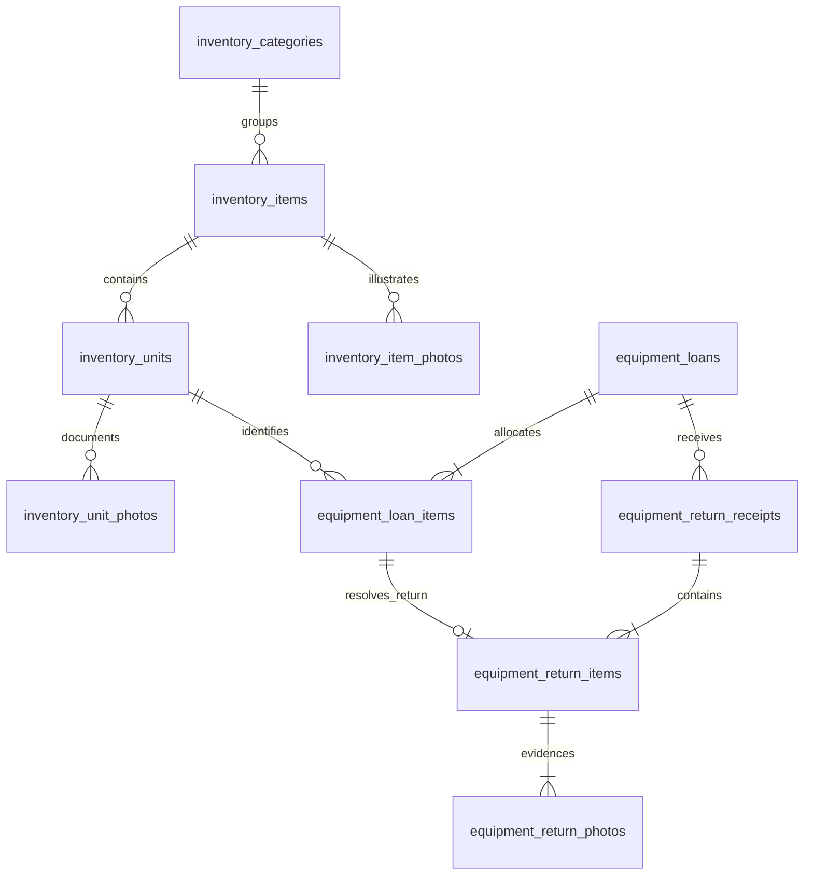

# WPiTV — Full Equipment Rebuild Plan

Phase 6C.4L.1 • Audit 21 November 2026 • **BLOCKED untuk finalisasi desain**

Dokumen ini hasil audit read-only dan usulan untuk ditinjau, bukan persetujuan schema atau pelaksanaan Phase 6C.4L.2. Hanya dokumen ini ditambahkan. Tidak ada migration, backfill, seed, cleanup, perubahan route, commit, push atau deployment.

## 1. Ruang lingkup, sumber, dan prasyarat

Audit mencakup database lokal `wpitv` dan `wpitv_testing`, schema expanded, model, service, route, policy, komponen Livewire, Blade, dashboard, media dan harness pengujian Equipment. Koneksi PDO langsung memakai konfigurasi lokal tanpa mencetak kredensial; seluruh pemeriksaan SQL berada dalam transaksi `READ ONLY` yang diakhiri rollback. Aplikasi tidak di-bootstrap untuk menghindari efek samping provider. Tidak ada suite mutatif dijalankan.

Sumber keputusan adalah kedua lampiran pengguna. Lampiran SQL berisi empat definisi VIEW dan sepuluh kontrak operasi Laravel; tidak berisi CREATE TABLE. Sebutan “SQL Claude” di bawah hanya merujuk cuplikan tersebut, bukan klaim telah memperoleh SQL lengkap dari sumber lain.

**Prasyarat belum tersedia:** `WPiTV_Equipment_Clean_Target_Schema_v2.sql` tidak ditemukan pada pencarian seluruh file workspace dengan nama schema maupun ekstensi `.sql` (di luar vendor/node_modules). SQL aplikasi lain di `docs/sql/2026-09-01-retire-peliputan-email.sql` bukan referensi Equipment. Isi Clean Schema v2 tidak direkonstruksi dari cuplikan VIEW. Perbandingan DDL lengkap, tipe, FK, CHECK, indeks dan strategi konversinya belum dapat dilakukan. Jika terdapat SQL Claude lengkap selain lampiran, diperlukan pula untuk audit lengkap.

Aturan eksplisit prompt full rebuild mengesampingkan penggunaan VIEW pada lampiran: target **tanpa database VIEW**. Diperlukan file v2 asli dan peninjauan hasil audit sebelum Phase 6C.4L.2. Usulan dalam dokumen ini belum merupakan finalisasi ERD/SQL.

## 2. Baseline aktual dan penyimpangan

Hasil SELECT/SHOW pada MySQL **8.0.30**, bukan asumsi berdasarkan laporan lama:

| Ukuran | Baseline prompt wpitv | Aktual wpitv | Aktual wpitv_testing |
| --- | ---: | ---: | ---: |
| Tabel / migration | 43 / 25 | 43 / 25 | 43 / 25 |
| Kategori | — | 7 | 7 |
| Barang induk | 11 | **12** | 10 |
| Unit fisik | 57 | **65** | 51 |
| Peminjaman / detail | 5 / — | 5 / 10 | 5 / 10 |
| Pinjaman aktif menurut aturan existing | 3 | 3 | 3 |
| Receipt / detail retur | 3 / 3 | 3 / 3 | 3 / 3 |
| Audit Equipment | — | 87 | 71 |
| Tersedia | 48 | **56** | 42 |
| Dipinjam / rusak / nonaktif / hilang | 7 / 1 / 1 / 0 | 7 / 1 / 1 / 0 | 7 / 1 / 1 / 0 |
| Metadata foto barang / unit / retur | — | 1 / 12 / 3 | 0 / 10 / 3 |
| Berkas media unik cocok ukuran + SHA-256 | 14 | **15 / 15** | 13 / 13 |
| Unit tanpa item_id | — | 0 | 0 |

Klasifikasi di tabel memakai aturan existing: lost dari detail aktif, kemudian borrowed, damaged, inactive, available. Total 65 = 56 + 7 + 1 + 1. Ada 16 metadata media utama yang mengacu ke 15 storage key unik; jumlah metadata tidak boleh dianggap jumlah file fisik. Hash dan ukuran seluruh file yang direferensikan diverifikasi read-only; audit ini tidak menyatakan inventaris seluruh file tanpa referensi maupun memeriksa ulang decode setiap gambar.

Kedua database memiliki **75 constraint FK / 79 pasangan kolom**, nol orphan ketika diperiksa sebagai constraint utuh termasuk FK komposit. Pemeriksaan awal per kolom memberi dua kecocokan parsial yang tidak valid untuk interpretasi orphan; hasil tersebut dikoreksi dengan pemeriksaan FK komposit. Tidak ada perbaikan data dilakukan. SHOW FULL TABLES menunjukkan seluruh 43 objek berupa BASE TABLE.

Ledger aktif `storage/app/testing/equipment-studio-ledger.json` terbaca versi **2**, SHA-256 `759c3da6c6ff10a7f12b7671bc6c581d8a919ff90ffa97921af499e4be380cae`, cocok laporan rollout sebelumnya. Berkas tidak diubah. Pencocokan hash ledger tidak sama dengan menjalankan verifikasi seluruh postimage baris miliknya; verifikasi kepemilikan lengkap tetap gate clone/cutover.

Perbedaan +1 item, +8 unit, +8 tersedia dan +1 file dari prompt harus direkonsiliasi dengan operator sebelum membekukan baseline migrasi. Audit tidak menyimpulkan penyebab, pemilik atau bahwa penambahan tersebut dummy. Semua **65 unit dan 12 item aktual** wajib dipertahankan, beserta penambahan valid berikutnya.

## 3. Inventaris seluruh tabel dan dependency

### 3.1 Tabel Equipment (jumlah baris utama / testing)

| Tabel | Baris | Relasi dan peran existing |
| --- | --- | --- |
| inventory_categories | 7 / 7 | Kategori item dan kategori duplikat pada unit; target audit |
| inventory_items | 12 / 10 | FK kategori; metadata master, item_code, next_unit_number, version |
| inventory_units | 65 / 51 | FK kategori dan item nullable; masih menyimpan metadata barang, condition, is_active, storage_location, retired_at/reason |
| inventory_unit_members | 53 / 41 | parent_id dan unit_id ke unit; parent fisik juga dipakai sebagai identitas barang |
| inventory_item_photos | 1 / 0 | FK item, uploaded_by ke users; revision dan storage key unik |
| inventory_unit_photos | 12 / 10 | FK unit dan audit; cover lama dan foto unit |
| equipment_loans | 5 / 5 | FK recorded_by ke users; borrower, due dates, token dan payload hash |
| equipment_loan_items | 10 / 10 | FK loan, unit, receiver; snapshot checkout dan fakta retur/loss |
| equipment_return_receipts | 3 / 3 | FK loan, audit unik nullable, receiver; kode receipt |
| equipment_return_items | 3 / 3 | FK receipt dan loan_item unik; mengulang fakta retur |
| equipment_return_photos | 3 / 3 | receipt_id menunjuk audit lama; return_receipt_id menunjuk receipt normalisasi |
| equipment_return_photo_items | 3 / 3 | Pivot foto ke loan_item, bukan return_item |
| equipment_audit_events | 87 / 71 | FK kategori/unit/loan/loan_item serta actor users; JSON sebelum/sesudah dan token |

Constraint penting yang benar-benar tersedia: kode item/unit unik; `(loan_id, inventory_unit_id)` unik; generated `active_unit_id` unik; return detail unik per loan_item; CHECK kondisi, kelengkapan fakta retur/loss, tanggal loan dan metadata foto. Actor FK memakai `INT UNSIGNED` sesuai users, sedangkan identitas Equipment memakai BIGINT. Generated active_unit_id saat ini hanya menguji `returned_at IS NULL`, sehingga **unit lost tetap menguasai slot aktif**.

### 3.2 Tiga puluh tabel di luar Equipment

Inventaris lengkap objek lainnya, dipertahankan tanpa redesign:

| Area | Tabel |
| --- | --- |
| Infrastruktur (3) | migrations, users, roles |
| Konten dan aktivitas (8) | ms_banner, ms_news, ms_program, ms_video, tr_perliputan, tr_usercounter, wpitv_agendas, wpitv_organization_positions |
| TVClub (6) | tvclub_generations, tvclub_group_members, tvclub_groups, tvclub_members, tvclub_organization_members, tvclub_organization_positions |
| TVClub Social (6) | tvclub_social_account_observations, tvclub_social_accounts, tvclub_social_events, tvclub_social_post_observations, tvclub_social_posts, tvclub_social_report_versions |
| Monthly Activity (5) | monthly_activity_attachments, monthly_activity_events, monthly_activity_items, monthly_activity_reports, monthly_activity_versions |
| Live Streaming (2) | live_stream_events, live_streams |

Metadata FK seluruh database ditinjau: relasi Equipment ke infrastruktur bersama adalah users; tidak ditemukan FK tabel modul lain menuju Equipment. Ketiadaan FK bukan bukti ketiadaan dependency kode. Dashboard bersama, menu admin, route, seeder UAT, script demo, policy dan test harness merupakan dependency kode yang harus diputus atau diadaptasi secara terkontrol. MonthlyActivityCandidates tidak menunjukkan referensi Equipment pada pencarian nama domain.

## 4. Masalah arsitektur existing dan bukti

| Temuan | Bukti kode | Dampak rebuild |
| --- | --- | --- |
| Identitas barang masih sama dengan unit akar | EquipmentStock::products/groupExpression; EquipmentQuantity::parentId; EquipmentPhotoController::unit mensyaratkan item_id = unit.id pada cover | Item baru tidak boleh mensyaratkan adanya unit akar atau kesamaan ID antar tabel; barang stok nol harus tampil |
| Dua struktur dibaca bersamaan | EquipmentStructure::installed, EquipmentStock::normalized, COALESCE item_id/membership/unit.id | Schema detection dan fallback bukan fondasi clean; satu kontrak setelah switch |
| Metadata item diduplikasi | InventoryUnit masih memiliki category/name/brand/model; EquipmentStructure::syncItem dan Units/Form::saveItem | Risiko drift dan update lintas objek; target metadata barang hanya di item |
| Status operasional belum eksplisit | Units memakai is_active, condition, retired_at; loss membuat is_active=false | maintenance/lost/retired tidak terwakili satu enum operasional; perlu pemetaan historis yang dapat dibuktikan |
| Semantik lost bertentangan dengan cuplikan | Loss meninggalkan active_unit_id; Return menerima lost dan menyimpan returned_at tanpa menghapus lost_at; Recovery mengaktifkan setelah inspeksi | Jangan mengganti definisi open/resolved diam-diam; tentukan recovery historis dan angka progres |
| Return punya beberapa representasi | EquipmentLoanReturn menghasilkan audit receipt dan EquipmentStructure::recordReceipt menyalin fakta ke receipt/detail | Tentukan satu pemilik fakta retur; audit adalah histori, bukan receipt operasional kedua |
| Relasi foto ambigu | receipt_id foto menunjuk audit, return_receipt_id menunjuk receipt, pivot menunjuk loan_item | Relasi clean harus langsung dapat membuktikan foto milik return detail pada loan yang sama |
| Generasi kode masih mengikuti unit akar | InventoryCode::issue memakai ID unit; EquipmentQuantity::adjust punya counter master dan fallback COUNT membership; suffix clean existing memakai minimal dua digit | Gunakan item independen dan counter monoton; pertahankan kode historis persis |
| Aturan input kategori melebihi definisi baru | EquipmentQuantity::adjust mewajibkan kategori aktif saat add stock | Putuskan kebijakan add stock existing item pada kategori nonaktif; jangan diwariskan tanpa review |
| Progress tersebar | EquipmentLoans/Index, Reports, ExtensionForm dan AdminDashboardMetrics menguji returned_at sendiri | Satu query progres, terpisah dari overdue dan status stok |
| Business mutation di Livewire | Inventory/Units/Form dan Categories/Form menjalankan transaksi langsung | UI menjadi adapter domain, bukan pemilik transaksi inventaris |
| Penyimpanan file tidak atomik dengan DB | EquipmentPhotos::stage menulis file sebelum commit; ReturnForm melakukan discardUnused di finally | Perlu lifecycle staging/finalisasi/rekonsiliasi aman terhadap retry dan crash |

Kekuatan existing yang perlu dipertahankan sebagai acceptance criteria, bukan dependensi arsitektur: transaksi, lock eksplisit, replay token+actor+hash, version stale check, audit rollback, UTC timestamp, snapshot checkout, policy dan media privat. Tidak ada temuan di atas yang memberikan izin menghapus implementasi berjalan sekarang.

## 5. Perbandingan SQL Claude dan Clean Schema v2

| Aspek | Cuplikan SQL tersedia | Existing | Rekomendasi untuk review v2 |
| --- | --- | --- | --- |
| Agregasi | Empat CREATE VIEW | Query service Laravel | Tolak DDL VIEW; pindahkan kontrak ke query terpusat |
| Kondisi/operasional | physical_condition + operational_status | condition + is_active + retirement metadata | Domain terpisah dengan CHECK enumerasi |
| Prioritas stok | lost → borrowed → damaged → inactive → available | lost dari active loan item | Pertahankan prioritas yang jelas; lost bersumber status unit target |
| Unit loanable | item aktif, active, good, tanpa loan | Struktur fallback dan kondisi legacy | Revalidasi di bawah lock, sertakan konflik reservasi bila benar-benar ada |
| Total | total_recorded_units dan operational_units | total dan active_units | Definisikan operational_units = bukan retired; active_units jangan dianggap sinonim |
| Progres | open mengecualikan returned dan lost | open hanya mengecualikan returned | Perubahan perilaku besar, perlu keputusan recovery/loss sebelum konversi |
| Recovery | lost → maintenance dengan audit baru | return dulu, kemudian reactivate | Histori kehilangan tetap immutable; jangan hitung satu detail dua kali pada progres |
| Drift | Hanya loan aktif dengan status/kondisi unit tak layak | Status operasional eksplisit belum ada | Pemeriksaan Laravel; histori recovered bukan drift otomatis |
| Transaksi | Lock, counter, audit, foto per return item | Sebagian besar tersedia dengan compatibility | Implementasi ulang tanpa mengandalkan struktur root |
| DDL lengkap | Tidak disertakan | Migration expanded tersedia | Clean Schema v2 **belum tersedia**, kesetaraan FK/CHECK/index belum dapat disimpulkan |

Cuplikan overview menjumlahkan returned_units dan lost_units secara independen. Existing mengizinkan satu detail memiliki kedua timestamp setelah recovery; menyalin rumus itu dapat menghitung penyelesaian ganda. Cuplikan juga bergantung pada definisi generated active_unit_id yang tidak disertakan. Ini harus menjadi keputusan eksplisit desain, bukan asumsi dari nama kolom.

## 6. Usulan struktur final untuk dibahas, belum disahkan

Cardinality minimal satu detail/foto adalah invariant service transaksi; FK saja tidak menjamin parent mempunyai child. Foto kelompok historis dapat memerlukan pivot foto–return_item sebagai alternatif relasi satu-ke-banyak di atas; keputusan v2 harus mempertahankan evidence yang sama tanpa kehilangan cakupan. Audit mengacu secara eksplisit pada kategori/item/unit/loan/loan_item/receipt sesuai event, dengan actor nullable dan snapshot nama; rincian FK menunggu schema asli.

Usulan kepemilikan data:

- Category menyimpan pengelompokan dan aktif/nonaktif. Item menyimpan kode immutable, nama, merek/model, kategori, notes, aktif, version dan counter nomor unit. Tidak menyimpan stok agregat.
- Unit menyimpan item wajib, kode immutable, serial, physical_condition, operational_status, version dan notes relevan unit. Tidak menambah storage_location; nilai existing tetap tersedia dalam arsip/snapshot historis yang dipetakan dan diverifikasi.
- Loan menyimpan identitas peminjam, borrowed_at, initial_due_at, due_at, actor dan version. Loan item menyimpan unit serta snapshot checkout immutable. Progress/overdue tidak menjadi kolom status tersimpan.
- Return receipt menjadi identitas batch. Return item menjadi sumber fakta pengembalian termasuk condition_in, waktu, tenggat saat kembali, catatan dan penerima; pilihan kolom penanda penyelesaian pada loan item harus diulas agar tidak menjadi salinan fakta kedua yang dapat drift.
- Photo menyimpan metadata tervalidasi, storage key server, ukuran, hash, uploader dan waktu; file privat. Audit append-only menyimpan perubahan dan hasil operasi. Lokasi persistensi token idempotency ditetapkan satu kali, bukan menggandakan kontrak replay loan dan audit tanpa alasan.

Domain yang disarankan: InventoryManagement (kategori/item/unit/kode), EquipmentQueries (stok/progres/drift/laporan/dashboard), EquipmentLending (checkout/return/loss/recovery/extension/correction), EquipmentMedia dan EquipmentAudit. Nama/ukuran service boleh disesuaikan setelah desain; tidak perlu satu service per aksi. Namespace baru terisolasi tidak boleh memanggil EquipmentStructure atau fallback legacy. Infrastruktur auth, RBAC, layout, timezone casting dan theme dapat tetap digunakan setelah kontraknya diperiksa.

FK historis RESTRICT, kode dan active allocation UNIQUE, CHECK enum/tanggal/kelengkapan metadata, indeks item+status+kondisi, unit+histori, loan+penyelesaian dan due_at harus dievaluasi menggunakan EXPLAIN pada clone. Actor FK harus cocok dengan tipe users. Aturan lintas baris seperti satu foto minimum, unit layak, jumlah detail nonzero dan satu loan untuk receipt/detail memerlukan service dan pengujian, tidak cukup CHECK lokal.

## 7. Keputusan bisnis yang wajib diselesaikan pada Phase 6C.4L.2

| Kasus | Arah yang diusulkan / hal yang harus disetujui |
| --- | --- |
| Kategori nonaktif | Tidak ditawarkan untuk item baru; histori dan transaksi lama tetap bisa dibaca; tidak otomatis menonaktifkan semua item |
| Item nonaktif | Checkout baru ditolak; return dan penyelesaian transaksi lama tetap diizinkan |
| Unit active + good | Loanable hanya jika item aktif, tanpa allocation aktif dan konflik lain |
| Good → damage | Kondisi berubah dengan audit; tidak otomatis retired; perubahan bebas saat borrowed ditolak dan diarahkan ke return/exception workflow |
| Active ↔ maintenance | Inspeksi, alasan, audit dan version wajib; checkout maintenance ditolak |
| Unit → retired | Tidak mempunyai allocation terbuka; histori tetap ada; nomor tidak didaur ulang; reversibilitas retirement perlu keputusan |
| Loan aktif → loss | Catat lost_at dan status unit lost atomik; putuskan apakah loss langsung menyelesaikan allocation dan overdue seperti cuplikan |
| Lost → recovered | Audit recovery baru; unit masuk maintenance; inspeksi terpisah untuk active; jangan hapus lost_at atau menulis ulang snapshot |
| Recovery setelah loss menutup loan | Tentukan receipt/evidence recovery terpisah atau detail return pada loan lama; progress tidak boleh double count |
| Partial return | Hanya unit milik loan terpilih, belum diselesaikan; minimal satu foto valid per detail; batch gagal seluruhnya bila satu invalid |
| Late + partial | Dua atribut independen; batas waktu dan due_at_on_return menjaga histori extension |
| Empty loan / zero stock item | Empty loan ditolak; zero stock item sah dan tetap muncul pada katalog |
| Reservasi | Tidak ditemukan tabel reservasi Equipment pada inventaris; jangan mengarang subsistem. Definisikan konflik nyata atau nyatakan belum berlaku |
| Waktu | UTC microseconds di DB; perilaku form existing memakai Asia/Jakarta/WIB. Jangan menggantinya dengan timezone komputer tanpa keputusan produk |

Kode baru: server menerbitkan item_code sekali, unit_code format seperti `SON-A6400-001-U001`, nomor monoton di bawah lock item dan UNIQUE DB. Jangan COUNT(*), jangan mengubah kode saat rename. Tentukan sequence item independen dan kebijakan gap/rollback pada desain. Kode historis dipertahankan apa adanya; jangan menambah suffix ulang ke unit akar lama. Mapping kode lama–ID target disimpan sebagai bukti konversi, bukan resolver fallback runtime.

Lock order harus ditetapkan lintas seluruh domain, termasuk category toggle, item edit/add stock, checkout, return, loss dan recovery. Untuk operasi loan: header bila existing, item terurut, unit terurut, lalu detail terurut merupakan kandidat; validasi dependensi dan race pada clone sebelum disahkan. Jangan mewarisi campuran lock root dan master. Retry token sama+actor+payload mengembalikan hasil sama, payload/actor berbeda ditolak. Reotorisasi dilakukan sebelum replay agar user nonaktif tidak mendapat hasil privat.

## 8. Kode yang akan diganti dan titik integrasi

Daftar berikut adalah inventaris kandidat penggantian setelah pengujian; **tidak dihapus pada audit**.

| Kelompok | File/direktori yang ditinjau |
| --- | --- |
| Model | app/Models/InventoryCategory.php, InventoryItem.php, InventoryUnit.php, EquipmentLoan.php, EquipmentLoanItem.php, EquipmentAuditEvent.php |
| Struktur compatibility | app/Services/EquipmentStructure.php, EquipmentStructureBackfill.php, EquipmentQuantity.php, EquipmentStock.php, InventoryCode.php |
| Mutasi loan | app/Services/EquipmentLoanCheckout.php, EquipmentLoanReturn.php, EquipmentLoanLoss.php, InventoryUnitRecovery.php, EquipmentLoanExtension.php, EquipmentLoanCorrection.php |
| Media/laporan | app/Services/EquipmentPhotos.php, EquipmentReports.php; app/Http/Controllers/EquipmentPhotoController.php, EquipmentReportExportController.php |
| UI inventory | app/Livewire/Admin/Inventory/Categories/{Index,Form}.php dan Units/{Index,Form,Show,StockAdjustment}.php; Blade pasangan pada resources/views/livewire/admin/inventory/ |
| UI loan | app/Livewire/Admin/EquipmentLoans/{Index,Form,Show,ReturnForm,LossForm,ExtensionForm,CorrectionForm,Reports}.php; Blade pasangan pada resources/views/livewire/admin/equipment-loans/ |
| Status/error | resources/views/components/equipment-status.blade.php; app/Support/EquipmentErrors.php; app/Exceptions/EquipmentOperationException.php; app/Livewire/Concerns/HandlesEquipmentErrors.php |
| Policy | app/Policies/InventoryCategoryPolicy.php, InventoryUnitPolicy.php, EquipmentLoanPolicy.php; tambah policy item/receipt/media sesuai desain tanpa mengganti RBAC bersama |
| Integrasi bersama | routes/web.php (blok Equipment), app/Support/AdminNavigation.php, app/Services/AdminDashboardMetrics.php, resources/views/livewire/admin/dashboard/equipment.blade.php |
| Schema | Seluruh migration Equipment 2026_11_08, foto 2026_11_19, membership 2026_11_20 dan expansion 2026_11_21; migration lama tetap immutable |
| Harness/data tooling | scripts/equipment-demo.php, database/seeders/WpitvUatSeeder.php, tests/Support/EquipmentLedgerReconciliation.php, EquipmentConcurrencyGuard.php, EquipmentScenarioTestCase.php, EquipmentPhotoFixtures.php, tests/EquipmentConcurrencyTestCase.php, phpunit.equipment.xml |
| Pengujian | tests/Integration/Equipment/{EquipmentIntegrationTest,EquipmentPhotoTest,QuantityStockTest}.php; tests/Concurrency/Equipment/{EquipmentConcurrencyTest,worker}.php; tests/Browser/EquipmentBrowserTest.php; tests/Unit/EquipmentSafetyTest.php dan EquipmentConcurrencyGuardTest.php |

Pembacaan source mendalam difokuskan pada transaksi, stok, struktur, model, route, policy, upload, dashboard dan form terkait; Blade/harness/tests ditinjau secara struktural melalui relasi, assertion dan pencarian dependency. Ini bukan klaim browser UAT atau eksekusi seluruh kode. Referensi laporan: EQUIPMENT_DATABASE_RESTRUCTURING_VERIFICATION.md, EQUIPMENT_STOCK_AND_PHOTO_VERIFICATION.md, EQUIPMENT_CONCURRENCY_TESTING.md, EQUIPMENT_REALISTIC_DEMO_DATA_VERIFICATION.md dan INVENTORY_LOAN_DESIGN.md. Hasil tes di laporan lama adalah bukti historis, bukan hasil tes fase ini.

Existing policy membolehkan Super Admin dan Admin Produksi yang aktif; correction dan reactivation khusus Super Admin; delete unit/category/loan ditolak. Pertahankan matriks ini kecuali ada keputusan eksplisit. Policy role tidak menggantikan pemeriksaan bahwa item, receipt dan foto berada pada loan yang sama. Jangan memakai storage_key browser. Pemeriksaan server MIME/signature/decode, batas 5 MiB/20MP, hash dan private response harus menjadi kontrak media baru.

## 9. Strategi histori, backup dan cutover

1. Bekukan baseline aktual setelah writer ditahan pada jadwal yang disetujui; rekam jumlah, DDL signature, hash baris, snapshot, code, audit, ledger, metadata dan file. Jangan menimpa laporan baseline lama seolah-olah sama.
2. Buat dump baru seluruh 43 tabel dan salinan media privat, manifest SHA-256 serta ledger immutable. Restore ke instance terisolasi, cocokkan setiap tabel dan seluruh FK. Audit sekarang tidak membuat backup baru. Laporan 6C.4J.4 mencatat backup privat `equipment-main-6c4j4-20261121-103924-a4cec7` yang berisi baseline 39 tabel sebelum expansion; itu bukan backup terbaru dari keadaan 65 unit saat ini. Ketersediaan/restorability backup tersebut tidak diverifikasi ulang pada fase ini.
3. Clone harus memakai instance/database, kredensial DML-only untuk suite, storage privat dan runtime tersendiri; provisioning DDL terpisah. Identitas target dan schema signature diverifikasi, guard tidak dilemahkan. Harness existing mengikat nama wpitv_testing; adaptasi clone memerlukan desain guard khusus, bukan pengalihan diam-diam koneksi utama.
4. EXPAND pada clone dengan migration baru dalam struktur terisolasi; COPY/BACKFILL deterministik dan idempotent. Simpan mapping untuk seluruh ID, unit akar yang tetap unit nyata, item, snapshot, audit, receipt dan relasi media. Ambiguitas atau baris tanpa pasangan memblokir tahap berikutnya.
5. Rekonsiliasi seluruh data termasuk unit yang baru ditambahkan; jalankan backfill dua kali, bandingkan mapping dan hash. Konversi is_active/retired/loss harus mengikuti keputusan bisnis dan tidak menafsirkan semua inactive sebagai maintenance tanpa bukti.
6. SWITCH READS/WRITES hanya setelah acceptance lulus dan approval cutover eksplisit. Satu arsitektur aktif per target; jangan membiarkan writer legacy dan clean mengubah fakta yang sama. Route ID historis dan tautan evidence diverifikasi terhadap mapping yang sudah dikonversi.
7. VERIFY stok, progres, overdue, histori extension, codes, snapshots, receipts, evidence, RBAC dan modul lain. Ledger v2 testing tidak diedit/diterbitkan ulang dalam fase ini. Prosedur ownership baru pada clone harus mencakup dependensi lengkap dan menolak baris luar ledger.
8. CONTRACT terpisah setelah seluruh dependency lama nol, rollback window ditutup dan arsip histori diverifikasi. Tidak ada mass RENAME, DROP/TRUNCATE/RESET atau edit migration terpasang sebagai shortcut. Penghapusan kode legacy baru diperbolehkan setelah bukti tidak dipakai; penghapusan data membutuhkan izin terpisah.

Rollback aplikasi setelah write clean tidak cukup dengan mengarahkan route ke legacy karena data baru akan hilang dari pembaca lama. Rencana recovery harus menetapkan batas waktu writer, rekonsiliasi write baru dan restore terkontrol; DDL MySQL dapat implicit commit. Jangan mengandalkan rollback transaksi untuk membatalkan migration.

## 10. Risiko dan pengamanan utama

| Risiko | Pengamanan / bukti wajib |
| --- | --- |
| Dokumen v2 hilang | Block finalisasi desain sampai file asli tersedia dan diperiksa |
| Baseline prompt sudah berbeda | Gunakan baseline aktual; identifikasi perubahan valid dan snapshot baru sebelum clone/cutover |
| Salah konversi loss/progres | Truth table sebelum/sesudah termasuk lost yang ditemukan kembali; jangan gandakan penghitung |
| Double booking/kode duplikat | Lock deterministik, UNIQUE, replay, multi-process race dan rollback batch |
| Foto orphan atau terhapus saat retry | Staging server-owned, validasi ulang metadata sebelum commit, cleanup hanya file terbukti tak direferensikan; uji crash/failure |
| IDOR dan PII | Policy aktif pada semua aksi/upload, scope receipt/detail/photo, private/no-store, export tanpa kebocoran kontak |
| Ledger rusak | Hash immutable, pemeriksaan ownership clone, tidak menjalankan cleanup demo pada sumber |
| Regresi modul lain | Integrasi terbatas pada blok Equipment; snapshot tabel non-Equipment dan tes auth/RBAC/dashboard/news/TVClub/live/agenda |
| Hilangnya histori lokasi/kode | Arsip immutable dan mapping terverifikasi; jangan menambah storage_location ke schema clean |

## 11. Roadmap dan acceptance criteria

| Fase | Deliverable dan batas scope | Acceptance criteria / gate |
| --- | --- | --- |
| 6C.4L.1 Architecture Audit | Dokumen ini, inventaris 43 tabel, dependency dan perbandingan sumber | Pembacaan sumber, baseline aktual, media dan FK tercatat; nol mutasi DB/ledger/media. Audit disampaikan dengan gap v2 yang eksplisit. Status finalisasi desain BLOCKED |
| 6C.4L.2 Database & Business Rules | ERD final, SQL tanpa VIEW, kontrak query/domain, status, kode, histori/cutover | V2 asli diaudit; selisih baseline direkonsiliasi; pemilik fakta tunggal; truth table seluruh transisi termasuk loss/recovery/late+partial; spesifikasi testable, constraint/indeks/tipe actor disetujui. Tidak ada DDL aktif; approval desain diperlukan sebelum backend |
| 6C.4L.3 Backend | Migration baru pada clone, model/domain/query/media/audit baru, konversi dan tests | Restore 43 tabel terverifikasi; nol orphan/unmapped; hash histori/media cocok; backfill kedua identik; catalog/dashboard memakai query sama; stok nol tampil; checkout otomatis/manual atomic, retur parsial dan foto wajib, replay lintas actor/payload aman; race checkout/counter/return/loss/extension benar; audit/storage failure rollback; RBAC/IDOR lulus; tanpa fallback legacy |
| 6C.4L.4 UI/UX | Kategori, catalog/item form, detail/unit/stok, POS, return/receipt, dashboard | Workflow petugas dibangun ulang; per-unit condition/evidence jelas; stale/version dan retry ditangani; tanpa harga/pembayaran; Mazer/Bootstrap existing, desktop/mobile, Light/Dark, label/form/error/loading dan keyboard diverifikasi browser; UI tidak memegang business transaction |
| 6C.4L.5 Regression/UAT/Cutover | Laporan regresi, backup/restore terbaru, rehearsal, UAT dan rencana recovery | Functional/security/concurrency/browser lulus pada clone; seluruh histori, ledger/media serta non-Equipment cocok; operator menyetujui UAT dan cutover; writer ditahan, satu arsitektur aktif; post-switch verifikasi dan recovery gate lulus. Arsip/cleanup kode hanya sesudah dependency nol, data tetap dipertahankan |

Audit fase ini selesai sebatas bukti yang tersedia. **Verdict: BLOCKED** untuk menyatakan READY FOR DESIGN karena Clean Schema v2 wajib belum tersedia; baseline sumber juga perlu direkonsiliasi. Tindak lanjut yang diperlukan adalah menyediakan SQL v2 asli dan meninjau temuan. Phase 6C.4L.2 tidak dimulai otomatis.
