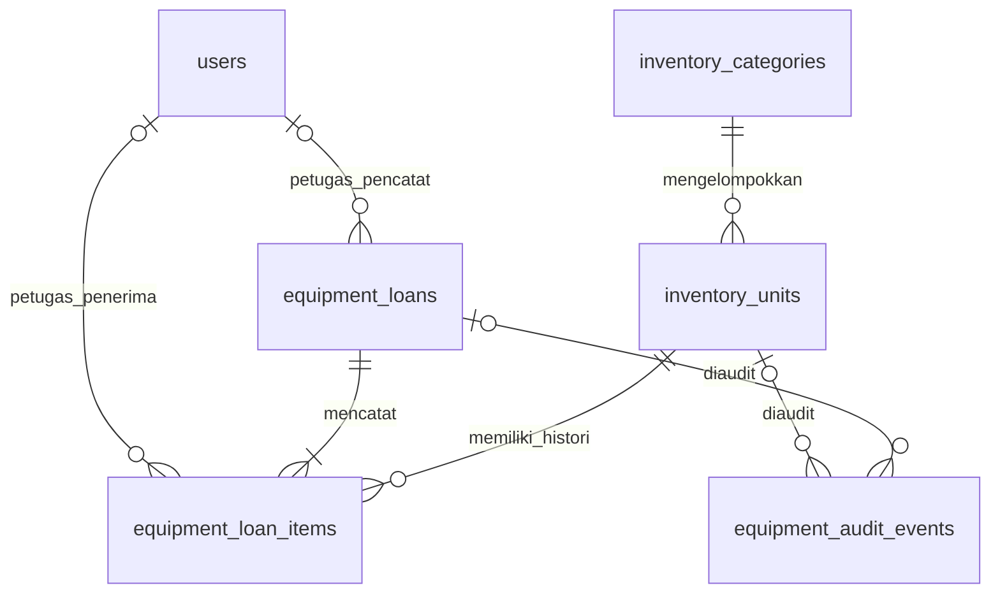

# Desain Inventaris dan Peminjaman Alat WPiTV

Status: desain final Phase 0C.1, belum diimplementasikan. Tanggal: 8 November 2026.

## 1. Ruang lingkup dan hasil audit kode

- Referensi otorisasi existing: [RBAC_ACCESS_MATRIX.md](RBAC_ACCESS_MATRIX.md). Hak modul baru di dokumen ini merupakan usulan tambahan, tidak mengubah hak existing.
- `Program` memakai Eloquent, relasi eksplisit, dan proteksi penghapusan dependensi pada Livewire Index. Pola ini dapat dipakai untuk kategori/unit.
- `Programs/Index` menggunakan pagination Bootstrap, filter URL, reset pagination, allowlist sorting, dan `InputBounds`. `Programs/Form` mengotorisasi mount, render, dan save; pola tersebut wajib diterapkan kembali.
- `Coverage` dan komponen Peliputan menyediakan pola daftar status, filter tanggal, detail, dan perubahan status. Status persetujuan Peliputan tidak disalin karena peminjaman ini langsung dicatat saat serah terima.
- `Users/Index` memperlihatkan `DB::transaction` dan `lockForUpdate`; ini fondasi penguncian transaksi baru.
- Route admin existing dilindungi `auth`, `session.valid`, `active`, dan role. `AppServiceProvider` memasang persistent middleware Livewire. Route grup empat role bukan izin untuk mengakses semua modul: policy tetap wajib.
- `AdminNavigation` memfilter link dengan Gate; `AdminDashboardMetrics` memilih cabang role sebelum query. Integrasi baru mengikuti keduanya sehingga News/TVClub tidak memuat data peminjam.
- Layout Mazer, `WPiAlert`, konfirmasi, flash message, dan tabel existing dapat digunakan ulang tanpa dependency tambahan.
- Snapshot lokal menunjukkan `users.id` adalah **INT UNSIGNED**, bukan BIGINT. FK petugas harus menyesuaikan tipe ini; verifikasi kembali metadata sebelum implementasi migration.
- Tidak ada SQL, migration, seeder, test suite, atau koneksi database yang dijalankan dalam fase desain ini. Status database dan testing dari audit sebelumnya bukan hasil pemeriksaan ulang.

## 2. Keputusan dasar

Satu baris unit mewakili satu benda fisik. Tidak ada kolom stok kuantitas sebagai pengganti unit. Dua kamera identik memiliki ID dan kode inventaris berbeda.

Peminjam adalah snapshot identitas pada transaksi, bukan akun autentikasi. Tidak ada FK wajib ke `users` atau anggota TVClub untuk peminjam. Akun TVClub tetap milik Ketua Umum dan tidak memperoleh akses modul ini.

MVP mencatat peminjaman saat alat diserahkan, tanpa reservasi masa depan atau draft persisten. Pengembalian boleh sebagian, per unit. Tidak ada penghapusan transaksi yang sudah tersimpan. Koreksi oleh Super Admin dicatat sebagai audit, tidak menghapus kejadian awal.

Ketersediaan dan kondisi dibedakan: unit aktif dengan kondisi baik dan tanpa detail pinjaman terbuka dapat dipinjam. Kondisi rusak ringan/berat memblokir peminjaman pada MVP sampai petugas memperbarui kondisi menjadi baik dengan alasan tercatat.

## 3. Rancangan tabel

Semua tabel baru memakai InnoDB dan utf8mb4_unicode_ci. `id` baru BIGINT UNSIGNED auto increment; seluruh FK antartabel baru BIGINT UNSIGNED. Semua tabel memiliki `created_at` dan `updated_at` DATETIME(6), kecuali event yang hanya `created_at`. Waktu disimpan UTC dan ditampilkan Asia/Jakarta mengikuti operasional WPiTV. Kolom NOT NULL kecuali ditandai nullable. FK memakai ON UPDATE RESTRICT; ID immutable.

### 3.1 `inventory_categories`

| Kolom | Tipe / aturan |
|---|---|
| id | PK |
| name | VARCHAR(100), UNIQUE; trim dan normalisasi spasi |
| description | VARCHAR(1000), nullable |
| is_active | BOOLEAN, default true |

Kategori mempunyai banyak unit. FK dari unit ON DELETE RESTRICT. Hard delete hanya untuk kategori tanpa unit; kategori terpakai dinonaktifkan. Kategori nonaktif tidak menerima unit baru atau perpindahan masuk; tidak otomatis menonaktifkan unit existing.

### 3.2 `inventory_units`

| Kolom | Tipe / aturan |
|---|---|
| id | PK |
| category_id | FK kategori, RESTRICT |
| inventory_code | VARCHAR(50), UNIQUE, uppercase; immutable setelah dipinjam |
| name | VARCHAR(150) |
| brand, model | masing-masing VARCHAR(100), nullable |
| serial_number | VARCHAR(100), nullable; indeks nonunique |
| storage_location | VARCHAR(150) |
| condition | VARCHAR(20): good, minor_damage, major_damage |
| is_active | BOOLEAN, default true |
| notes | TEXT, nullable; batas aplikasi 5000 karakter |
| version | INT UNSIGNED, default 1; deteksi form stale |

Indeks tambahan: `(category_id, is_active, condition)`, `(is_active, condition)`, `name`. Nomor seri tidak diwajibkan unik karena label pabrikan bisa tidak tersedia/tidak konsisten. Tidak ada kolom availability yang bisa diedit manual.

Unit mempunyai banyak detail pinjaman. Hard delete hanya jika tidak pernah dipinjam, FK detail RESTRICT menjadi pertahanan terakhir. Setelah memiliki histori, gunakan `is_active=false`; jangan gunakan cascade atau menghapus snapshot. Perubahan identitas/kondisi/penonaktifan saat unit sedang dipinjam ditolak; koreksi tunggu proses pengembalian atau prosedur Super Admin yang diaudit.

### 3.3 `equipment_loans`

| Kolom | Tipe / aturan |
|---|---|
| id | PK |
| loan_code | VARCHAR(40), UNIQUE; dibuat server, bukan MAX(id)+1 |
| submission_token | CHAR(36), UNIQUE; UUID idempotensi submit dari form |
| checkout_actor_key | VARCHAR(64), immutable, identitas server `users:{id}` tanpa FK; bertahan jika akun dihapus |
| checkout_payload_hash | CHAR(64) ASCII binary, SHA-256 payload checkout kanonis, immutable |
| borrower_name | VARCHAR(150) |
| student_number | VARCHAR(30); string agar nol awal terjaga |
| study_program | VARCHAR(150) |
| whatsapp_number | VARCHAR(16); normalisasi digit internasional tanpa tanda + |
| purpose | TEXT; batas aplikasi 3000 karakter |
| borrowed_at | DATETIME(6), waktu serah terima aktual |
| due_at | DATETIME(6), batas kembali |
| initial_due_at | DATETIME(6), jatuh tempo awal immutable |
| recorded_by | INT UNSIGNED nullable, FK users ON DELETE SET NULL |
| recorded_by_name | VARCHAR(100), snapshot wajib dari server |
| notes | TEXT nullable; batas 5000 karakter |
| version | INT UNSIGNED default 1 |

Indeks: `due_at`, `borrowed_at`, `student_number`, `recorded_by`. Jangan UNIQUE NIM: satu mahasiswa bisa memiliki beberapa transaksi. Identitas peminjam tidak ditulis ke parameter URL atau log aplikasi.

Status header **diturunkan**, tidak disimpan: active jika semua detail belum kembali, partially_returned jika sebagian kembali, returned jika semua kembali. Indikator unresolved_loss berlaku jika ada detail lost_at terisi dan returned_at NULL; indikator ini bisa berdampingan dengan partially_returned dan overdue. Alat hilang tetap merupakan kewajiban terbuka. Overdue jika ada detail belum kembali dan waktu sekarang melewati due_at. Waktu selesai header adalah MAX(returned_at) hanya jika semua detail sudah kembali. Header tanpa detail tidak boleh ter-commit.

### 3.4 `equipment_loan_items`

| Kolom | Tipe / aturan |
|---|---|
| id | PK |
| loan_id | FK equipment_loans, ON DELETE RESTRICT |
| inventory_unit_id | FK inventory_units, ON DELETE RESTRICT |
| unit_snapshot | JSON; kode, nama, kategori, merek, model, serial, lokasi saat pinjam; field nullable tetap disertakan |
| condition_out | VARCHAR(20), nilai kondisi alat saat serah terima |
| checkout_notes | TEXT nullable, batas 3000 karakter |
| returned_at | DATETIME(6), nullable |
| condition_in | VARCHAR(20), nullable sebelum kembali |
| return_notes | TEXT nullable, batas 5000 karakter |
| due_at_on_return | DATETIME(6), nullable sebelum kembali; snapshot jatuh tempo yang berlaku saat pengembalian |
| lost_at | DATETIME(6), nullable; waktu kehilangan dilaporkan, immutable setelah dicatat |
| loss_notes | TEXT nullable, wajib saat lost_at terisi; batas 5000 karakter |
| received_by | INT UNSIGNED nullable, FK users ON DELETE SET NULL |
| received_by_name | VARCHAR(100), nullable sebelum kembali; snapshot server |
| active_unit_id | BIGINT UNSIGNED generated stored: inventory_unit_id bila returned_at NULL, selain itu NULL |

Constraint utama: UNIQUE `(loan_id, inventory_unit_id)` dan UNIQUE `active_unit_id`. MySQL mengizinkan banyak NULL pada UNIQUE: unit yang sudah kembali bisa masuk transaksi baru, tetapi hanya satu detail terbuka untuk unit yang sama. Ekspresi generated hanya bergantung pada baris detail, bukan status header atau waktu saat ini.

Indeks tambahan `(loan_id, returned_at)` dan `(inventory_unit_id, id)`, serta indeks FK received_by. Indeks UNIQUE loan+unit sudah mencakup pencarian berdasarkan loan_id.

CHECK pada tabel baru: kondisi hanya tiga nilai yang ditetapkan; condition_in, received_by_name dan due_at_on_return wajib bila returned_at terisi; ketiganya serta received_by NULL sebelum kembali. FK received_by boleh NULL setelah akun dihapus. lost_at dan loss_notes harus keduanya NULL atau keduanya terisi; kehilangan tidak mengisi returned_at. CHECK header: due_at >= initial_due_at AND initial_due_at >= borrowed_at. Perbandingan tanggal detail terhadap header dilakukan service karena lintas tabel. CHECK bukan pengganti validasi aplikasi.

Service memastikan initial_due_at=due_at ketika checkout dan mengisi kedua nilai dari input awal yang sama. Histori jatuh tempo item selesai tidak diubah oleh operasi berikutnya.

Snapshot item tidak berubah ketika master berubah. Tampilan histori menggunakan snapshot, dengan tautan opsional ke unit saat ini. Semua detail pinjaman minimal satu dan dilarang dihapus; tidak ada quantity karena satu detail = satu unit.

### 3.5 `equipment_audit_events` (tabel pendukung baru)

Audit tambahan dibutuhkan agar perubahan master/koreksi tetap bisa ditelusuri; timestamp dan updated_by saja tidak cukup.

| Kolom | Tipe / aturan |
|---|---|
| id | PK |
| category_id, unit_id, loan_id, loan_item_id | BIGINT UNSIGNED nullable, FK tabel baru terkait, ON DELETE RESTRICT |
| event_type | VARCHAR(40), allowlist: created, updated, archived, checkout, returned, corrected |
| operation_token | CHAR(36) ASCII binary nullable, UNIQUE; wajib pada event receipt checkout/return/loss/extension/correction |
| operation_actor_key | VARCHAR(64) nullable; identitas server immutable `users:{id}`, wajib jika operation_token terisi |
| operation_payload_hash | CHAR(64) ASCII binary nullable, wajib jika operation_token terisi |
| actor_id | INT UNSIGNED nullable, FK users ON DELETE SET NULL |
| actor_name | VARCHAR(100), snapshot wajib |
| reason | VARCHAR(1000), wajib untuk koreksi/ubah kondisi/arsip/hapus |
| before_data, after_data | JSON nullable; allowlist atribut; tidak berisi password, session, atau salinan token operasi |
| created_at | DATETIME(6) |

Satu atau lebih FK target wajib terisi; CHECK melarang semuanya NULL kecuali event_type report_exported yang tidak memiliki target tunggal. Event tidak dihapus dan FK target tidak dilepas. Master yang sudah memiliki event wajib diarsip, bukan hard delete. Karena pembuatan master mencatat event secara atomik, CRUD operasional menggunakan arsip; hard delete hanya relevan untuk master tanpa histori/event (misalnya data impor yang belum digunakan). Semua penghapusan master tetap dibatasi FK RESTRICT.

Tambahkan event_type `lost`, `extended`, dan `report_exported`. Satu aksi batch menghasilkan tepat satu event receipt pada loan_id, berisi daftar item dan hasil per item dalam JSON; event receipt return/loss tidak memerlukan loan_item_id. Event tambahan per item tidak diperlukan. CHECK metadata operasi seluruhnya NULL atau seluruhnya terisi. Token operasi UUID divalidasi dan disimpan lowercase ASCII binary (termasuk submission_token); bukan secret otorisasi. Event checkout memakai token yang sama dengan header. Untuk event dengan loan_item_id, service memastikan loan_id dan unit_id sesuai detail tersebut; FK individual tidak menjamin konsistensi lintas target ini. Semua event dan perubahan bisnis di-commit atomik. Receipt checkout/return/loss/extension/correction wajib memiliki loan_id; receipt checkout juga harus cocok dengan submission_token, checkout_actor_key dan checkout_payload_hash header. Service memverifikasi kontrak ini, karena FK/CHECK tidak dapat membandingkan isi lintas tabel. Receipt immutable dan tidak mengubah actor key saat FK actor menjadi NULL. Hash tidak digunakan untuk autentikasi dan tidak diekspor/dicetak pada log.

Urutan lock baku: operasi pinjaman existing header -> unit ID naik (jika perlu) -> detail ID naik -> insert audit. Checkout baru unit ID naik -> insert header/detail/audit; pemeriksaan receipt saat memegang unit tidak mengambil lock header pinjaman existing. Gunakan current read receipt immutable melalui read berumur statement atau transaksi baru setelah rollback, jangan snapshot transaksi lama. Mutasi master hanya mengunci unit dan tidak mengambil lock header setelahnya. Jika menemukan pinjaman terbuka, tolak dan arahkan ke alur pinjaman; jangan memanggil return/loss dari dalam transaksi master. FK implisit tetap dapat menyebabkan deadlock sehingga retry terbatas wajib.

Indeks `(loan_id, created_at, id)`, `(unit_id, created_at, id)`, `(category_id, created_at, id)`, `(loan_item_id, created_at, id)`, `(actor_id, created_at)`. Event transaksi append-only melalui service; petugas tidak mendapat UI edit/hapus event. Privilege DML bukan bukti log tahan manipulasi administrator database. Jangan duplikasi NIM/WA pada event yang tidak memerlukannya; akses audit transaksi hanya Super Admin.

### Relasi ringkas

## 4. Alur peminjaman dan pencegahan race condition

1. Petugas aktif yang diizinkan membuka form internal, mengisi identitas, keperluan, tanggal dan memilih 1..50 unit berbeda. Batas 50 adalah default operasional yang dapat ditinjau.
2. Pilihan menampilkan kode/nama/kondisi/lokasi dan ketersediaan terkini. Kondisi keluar bersumber dari master terkunci; petugas mengonfirmasi kondisi nyata. Ketidaksesuaian diselesaikan melalui pembaruan master yang diaudit sebelum checkout.
3. Save mengotorisasi ulang actor dari server; tidak menerima recorded_by, snapshot, active_unit_id, atau status dari payload.
4. Satu `DB::transaction`: periksa receipt token checkout sebelum validasi keadaan unit; lock seluruh unit terpilih dengan urutan ID naik melalui `lockForUpdate`, lalu baca ulang receipt dengan current read sebelum memutuskan unit tidak tersedia. Validasi ulang aktif, kondisi baik, versi, dan tidak ada detail terbuka. Pemeriksaan ketersediaan memakai current/locking read, bukan snapshot read yang stale.
5. Buat header, seluruh detail dan event checkout atomik. Kode pinjaman misalnya PJM-YYYYMMDD-random dengan UNIQUE dan retry benturan terbatas. Tidak menyalin pola generate-then-exists Peliputan sebagai satu-satunya jaminan unik.
6. UNIQUE active_unit_id menjadi penjaga terakhir termasuk jalur tulis lain. Konflik unique atau unit tak tersedia membatalkan seluruh transaksi dan menghasilkan pesan unit sudah dipinjam; jangan membocorkan SQL. Tidak ada commit sebagian daftar alat.
7. Submit berulang dengan token sama mengembalikan transaksi sama hanya jika checkout_actor_key dan checkout_payload_hash cocok; payload/actor berbeda ditolak. Token tidak menjadi pengganti otorisasi.

### 4.1 Kontrak idempotensi checkout

Server menerbitkan UUID sekali per form dan mempertahankannya untuk retry; form baru mendapatkan token baru. Identitas berasal dari actor terautentikasi, bukan recorded_by nullable, nama yang bisa berubah, session ID, atau input browser. Replay tetap memerlukan akun aktif dan policy terkini; akun yang sudah dihapus tidak bisa replay walaupun snapshot identitas masih ada.

Payload hash dihitung server dari JSON berformat versi `checkout-v1`: identitas peminjam yang dinormalisasi, purpose/notes, borrowed_at dan due_at UTC dengan presisi tetap, serta item berurut unit ID yang memuat ID, expected version dan checkout_notes. Tetapkan urutan key, null untuk field opsional kosong, trim teks, normalisasi newline, dan normalisasi WA sebelum hashing. Waktu aktual yang default harus ditetapkan sekali di form dan dikirim ulang stabil, bukan dihitung ulang dari now pada retry. Snapshot master/kondisi server dan waktu created_at tidak menjadi input hash. Jangan membandingkan hash dengan kolom header yang mungkin telah dikoreksi atau due_at yang telah diperpanjang; hash awal immutable adalah referensi.

Jika dua request token sama lolos pemeriksaan awal, UNIQUE submission_token/operation_token memilih satu pemenang. Request kalah melakukan rollback penuh, lalu membaca transaksi pemenang lewat transaksi/read baru (bukan snapshot lama), mengotorisasi ulang dan membandingkan actor/hash; hasil cocok dikembalikan tanpa event baru. Bedakan nama constraint: konflik active_unit_id dengan token berbeda berarti alat tidak tersedia, bukan replay sukses. Setelah menunggu lock unit, cek receipt ulang juga menangani retry token sama dengan daftar unit identik. Jika receipt belum terlihat karena transaksi pemenang rollback, retry seluruh operasi secara terbatas. Konflik token beda payload tidak ditangani sebagai sukses. Tidak ada gap lock token yang belum ada sebagai mekanisme utama.

Lock dan UNIQUE melindungi dua request yang bersamaan, termasuk ketika belum ada detail aktif yang dapat dikunci. Jangan hanya memeriksa availability sebelum transaksi. Semua perubahan master juga mengambil lock unit dan memeriksa versi. Retry deadlock terbatas (misalnya 3), dengan seluruh transaksi diulang; tidak ada notifikasi eksternal di dalam closure retry.

## 5. Alur pengembalian

1. Petugas membuka transaksi aktif, memilih sebagian/semua unit belum kembali, memasukkan waktu aktual, kondisi masuk, dan catatan. Kondisi rusak mewajibkan catatan; keterlambatan terdeteksi server dan mewajibkan catatan alasan/keterangan.
2. Otorisasi ulang, mulai transaksi, lock header pinjaman terlebih dahulu, lalu unit urut ID, kemudian detail urut ID. Ini urutan baku semua operasi terhadap pinjaman existing; checkout baru tidak mengunci header existing untuk menghindari inversi lock pada jalur layanan ini; deadlock implisit indeks/FK tetap ditangani dengan retry terbatas.
3. Periksa receipt operasi sebelum validasi versi/status. Jika belum ada, validasi ulang kepemilikan seluruh detail terhadap loan, status belum kembali, tanggal dan versi header yang diharapkan. Detail yang sudah kembali menyebabkan seluruh batch ditolak; kesamaan nilai saja bukan bukti replay.
4. Set returned_at/condition_in/penerima server dan due_at_on_return dari header terkunci, update kondisi master dan versinya, naikkan versi header, append satu receipt return, commit atomik. Generated active_unit_id menjadi NULL; unit dapat dipinjam lagi hanya jika aktif dan baik. Unit pernah hilang tetap nonaktif setelah ditemukan/dikembalikan.
5. Unit lain tetap dipinjam sampai diterima. Status header otomatis menjadi partially_returned atau returned. Keterlambatan historis item memakai due_at_on_return, bukan due_at header yang dapat berubah setelah pengembalian parsial. Keterlambatan aktif memakai waktu sekarang dan due_at terkini.

### 5.1 Idempotensi pengembalian parsial

Setiap batch return memiliki operation_token baru dan satu payload kanonis `return-v1`: loan_id, expected header version, daftar item ID terurut dengan returned_at UTC, condition_in dan notes per item. actor key dan hash disimpan pada receipt audit. Token tetap sama selama retry batch yang sama; batch lain selalu memakai token baru. Aturan kanonisasi mengikuti checkout.

Setelah header terkunci, receipt token yang sudah ada harus cocok pada loan, event_type, actor key dan hash untuk mengembalikan hasil yang disimpan tanpa menulis ulang kondisi/unit. Ini dilakukan sebelum pemeriksaan stale version, termasuk jika unit kemudian dipinjam transaksi lain. Token berbeda atau actor berbeda tidak pernah dianggap replay berdasarkan nilai kondisi yang kebetulan sama.

Dua request pada loan sama diserialkan oleh lock header: token/payload/actor sama menghasilkan satu perubahan dan satu receipt; token sama tetapi payload berbeda menghasilkan konflik; token berbeda dengan item tumpang tindih ditolak atomik pada request kedua. Dua batch tidak tumpang tindih dengan expected version sama: batch kedua ditolak sebagai stale, petugas refresh dan submit batch baru dengan token/version baru. Tidak ada batch yang diam-diam melewati item selesai atau hanya menyimpan sebagian pilihannya. Konflik UNIQUE operation_token lintas loan ditangani setelah rollback dengan membaca receipt terbaru dan memvalidasi seluruh identitas operasi; jika tidak cocok, tolak.

### 5.2 Alat hilang dan ditemukan kembali

Super Admin dan Admin Production dapat melaporkan kehilangan untuk item belum kembali, dengan lost_at aktual, alasan wajib dan token operasi `loss-v1` (loan_id, expected version, item ID terurut, waktu dan catatan). Gunakan kontrak receipt yang sama. Lock header, unit urut ID, detail urut ID; naikkan versi header/unit, isi lost_at/loss_notes, set unit is_active=false, dan append receipt lost. Validasi borrowed_at <= lost_at <= sekarang. lost_at tidak boleh dihapus/diganti oleh form edit umum; replay diperiksa sebelum state/version, token baru untuk item sudah hilang ditolak.

returned_at tetap NULL sehingga UNIQUE active_unit_id tetap mengunci unit. Transaksi tetap terbuka dengan unresolved_loss; tidak ada status administratif yang membebaskan unit atau menghapus kewajiban. Arsip master tidak menghilangkan histori maupun lock. Tidak ada denda, ganti rugi, write-off atau pelunasan otomatis pada MVP.

Jika alat ditemukan, gunakan pengembalian normal dengan catatan penemuan wajib dan returned_at >= lost_at. lost_at/loss_notes tetap menjadi histori; penerima/kondisi masuk dicatat. Unit tetap is_active=false walaupun kondisi baik. Hanya Super Admin boleh mengaktifkan kembali unit pernah hilang setelah inspeksi dan alasan audit, dengan lock unit serta verifikasi tidak ada detail terbuka. Rekaman kehilangan tetap terlihat pada histori. Alat yang belum ditemukan tidak dapat diaktifkan kembali atau dipinjam.

### 5.3 Perpanjangan jatuh tempo

Super Admin dan Admin Production boleh memperpanjang hanya transaksi yang masih memiliki item belum kembali dan tanpa unresolved_loss. Hanya memperbesar due_at, tidak boleh memundurkan atau menyamai nilai lama; due_at baru harus melampaui waktu sekarang. Perpanjangan setelah jatuh tempo diizinkan dengan alasan wajib, tetapi keterlambatan yang sudah terjadi tidak dihapus dari event.

Operasi `extension-v1` memuat loan_id, expected header version, new_due_at UTC dan alasan; token/actor/hash disimpan sebagai receipt. Lock header, cek replay lebih dahulu, cek expected version dan status, lalu set due_at, naikkan version dan tulis event extended atomik. Tidak mengunci unit/detail karena seluruh return/loss/koreksi pinjaman juga wajib memegang header lebih dahulu. Dua perpanjangan berbeda dengan versi sama: satu menang, lainnya stale; perpanjangan bersamaan return mengikuti urutan lock header.

initial_due_at immutable. Event memuat due_at lama/baru, waktu aksi server, alasan, actor, item yang masih terbuka dan durasi overdue yang sudah terjadi saat aksi. Perpanjangan berlaku hanya untuk item terbuka; due_at_on_return item selesai tidak berubah. Laporan membedakan jatuh tempo awal, saat kembali, terkini, serta perpanjangan setelah terlambat. Tidak ada editing due_at lewat CRUD/koreksi umum; pembetulan yang mengurangi jatuh tempo belum didukung.

Tidak ada status cancelled untuk membebaskan unit yang sudah dibawa. Koreksi Super Admin hanya untuk identitas peminjam dan catatan dengan alasan/event corrected serta token/actor/hash `correction-v1`; lock header, cek replay lalu expected version, naikkan version. Tidak mengubah tanggal, unit, kondisi keluar/masuk, lost_at, snapshot awal atau metadata receipt. Kesalahan checkout yang sebenarnya belum terjadi dicatat sebagai pengembalian administratif pada alur return dengan alasan eksplisit. Tidak boleh mengosongkan returned_at atau mengaktifkan ulang pinjaman. Kesalahan tanggal/kondisi yang sudah final memerlukan prosedur lanjutan di luar MVP, tanpa penghapusan histori.

## 6. RBAC dan antarmuka

| Aksi | Super Admin | Admin Production | Admin News | TVClub |
|---|---|---|---|---|
| Lihat kategori/unit dan histori unit | Ya | Ya | Tidak | Tidak |
| Tambah/ubah/arsip master | Ya | Ya | Tidak | Tidak |
| Hapus master tanpa dependensi/event | Ya | Ya | Tidak | Tidak |
| Lihat transaksi dan identitas peminjam | Ya | Ya | Tidak | Tidak |
| Catat peminjaman/pengembalian/kehilangan/perpanjangan | Ya | Ya | Tidak | Tidak |
| Aktifkan kembali unit pernah hilang | Ya | Tidak | Tidak | Tidak |
| Koreksi historis dan lihat audit transaksi | Ya | Tidak | Tidak | Tidak |
| Lihat dan ekspor riwayat/laporan | Ya | Ya | Tidak | Tidak |
| Hapus transaksi/detail/event | Tidak | Tidak | Tidak | Tidak |

Petugas nonaktif ditolak untuk semua aksi. Super Admin mengelola seluruh transaksi melalui koreksi yang terlacak, bukan penghapusan histori.

Rencana policy: InventoryCategoryPolicy, InventoryUnitPolicy, EquipmentLoanPolicy dengan viewAny/view/create/update/archive/delete dan aksi recordReturn/reportLoss/extend/reactivateRecovered/correct/viewReport/exportReport/viewAudit sesuai tabel. Jangan memakai `canManageProgramsAndTVClub`, karena helper itu mengizinkan TVClub. Pakai pola aktif + Super Admin/Production seperti CoveragePolicy, dengan hak khusus Super Admin terpisah.

Rencana route hanya di bawah `/admin`: `/inventory/categories`, `/inventory/units`, `/inventory/units/{unit}`, `/equipment-loans`, `/equipment-loans/create`, `/equipment-loans/{loan}`, `/equipment-loans/{loan}/return`, serta `/equipment-loans/reports` dan endpoint ekspor terautentikasi untuk Super Admin/Production. Daftarkan route reports sebelum parameter loan. Form master punya create/edit sesuai pola existing; seluruh mount/render/mutasi Livewire mengotorisasi ulang, ID dari browser selalu di-resolve server. Tidak ada route/form publik atau akun peminjam.

Sidebar Operasional menambah Inventaris dan Peminjaman Alat hanya untuk Super Admin/Production; kategori submenu inventaris. Dashboard kedua role menampilkan jumlah unit aktif, tersedia, dipinjam, rusak, transaksi overdue, dan lima jatuh tempo terdekat tanpa NIM/WA. Tombol catat pinjaman, pengembalian, dan kelola unit mengikuti policy. Dashboard News/TVClub tidak menjalankan query modul ini. Laporan Super Admin/Production: periode pinjam/kembali terdefinisi jelas, kondisi rusak/hilang, perpanjangan, keterlambatan dan histori unit. Ekspor CSV streaming menggunakan fasilitas PHP/Laravel existing, filter dan policy yang sama dengan halaman laporan; satu baris per item, header transaksi diulang bila perlu. Periode dan timezone tercantum; tanggal pinjam atau tanggal kembali dipilih eksplisit, baris belum kembali tidak masuk filter tanggal kembali. Netralisasi formula spreadsheet pada teks yang diawali =, +, -, @ atau karakter kontrol; escape CSV dengan writer standar. Ekspor tidak disimpan pada storage publik dan respons memakai private/no-store. Kolom NIM/WA tidak disertakan secara default; opsi internal eksplisit untuk kedua role jika diperlukan. Identitas pengunduh, waktu, filter dan jumlah baris dicatat sebagai event audit report_exported tanpa menyalin data peminjam; ekspor global tanpa loan_id diperbolehkan khusus event ini. Event mencatat percobaan/selesainya pembuatan stream, bukan bukti file telah diterima pengguna.

## 7. Validasi dan perlindungan data

- Kode inventaris 1..50 karakter `[A-Z0-9._/-]`, trim/uppercase; UNIQUE DB tetap otoritatif. Nama/kategori/lokasi wajib sesuai panjang kolom. Kondisi/status masuk allowlist, tidak mempercayai hidden field.
- NIM wajib string alfanumerik dengan `-`/`.` bila diperlukan, maksimal 30; format kampus final perlu konfirmasi. Tidak membuat akun atau mencocokkan NIM otomatis dengan direktori publik.
- WA dinormalisasi (08 menjadi 628), validasi 8..15 digit setelah normalisasi. Nomor tidak dikirim ke API eksternal hanya untuk validasi.
- borrowed_at aktual <= sekarang; due_at >= borrowed_at; returned_at >= borrowed_at dan <= sekarang. Form menggunakan timezone aplikasi, konversi UTC eksplisit. Input tanggal masa lalu diizinkan untuk pencatatan terlambat, tetapi waktu input tetap pada created_at dan petugas wajib memberi alasan.
- ID unit integer distinct, exists, aktif, layak, dan tersedia diperiksa ulang di dalam lock. Batas item dan ukuran teks melindungi request berlebihan. Pagination 10/25/50, search maksimum 150, sorting allowlist dan eager loading.
- Data peminjam hanya di halaman internal yang diizinkan. Escape Blade, teks biasa untuk catatan; tidak ada raw HTML, upload dokumen, tautan unduhan publik, atau pencarian global publik.
- FK dan snapshot petugas mempertahankan atribusi bila akun dihapus. Identitas actor, waktu input, snapshot unit, kode dan kondisi keluar diisi server. Audit disimpan dalam transaksi yang sama dengan perubahan.
- Master berhistori diarsip, transaksi tidak dihapus. Tidak memakai soft delete untuk membypass UNIQUE kode atau mempertahankan lock alat secara tersembunyi.
- Retensi NIM/WA dan prosedur koreksi/anonymisasi harus disepakati pemilik data; jangan menyimpan salinan PII tanpa batas pada audit/ekspor/log.

## 8. Migration dan implementasi bertahap

Rencana ini menambah empat tabel inti dan satu tabel audit, tanpa ALTER/DROP terhadap 17 tabel existing. FK users didefinisikan dari tabel baru; tidak perlu relasi balik pada model User untuk versi awal. Tidak ada seeder role atau akun baru.

1. **Gate kesiapan:** selesaikan autentikasi runner, `.env.testing`, identitas dan isolasi runtime; verifikasi backup yang disetujui dan metadata users.id. Sepakati keputusan bisnis pada bagian 9. Belum menjalankan test suite selama gate ini.
2. **Skema additive:** siapkan migration kategori, unit, header, detail (generated UNIQUE/CHECK), lalu audit; review diff SQL dan indeks. Provisioning skema testing dilakukan terpisah dengan izin, bukan memakai runner DML. Migration tidak otomatis dijalankan saat aplikasi boot/deploy.
3. **Master:** model/policy kategori dan unit; CRUD/arsip serta pencarian/filter/pagination; histori unit memakai snapshot. Tambahkan service audit dan kontrol versi sebelum mutasi master dibuka.
4. **Checkout:** service transaksi tunggal, locks/UNIQUE/idempotensi, form internal dan detail read-only. Tidak membuka form yang hanya memiliki validasi availability client-side.
5. **Return dan lifecycle:** batch parsial idempoten, kondisi masuk, kehilangan/temuan, perpanjangan, audit overdue dan penutupan turunan. Tambahkan koreksi Super Admin dengan batas di atas.
6. **Integrasi UI:** navigasi dan dashboard kedua role, laporan/CSV kedua role, empty/error state dan pesan konflik; tidak mengubah fitur existing.
7. **Verifikasi dan rilis terpisah:** setelah izin dan isolasi siap, uji otorisasi empat role (URL dan replay Livewire), dua koneksi MySQL serentak checkout/return/loss/extension, replay token sama setelah perubahan master/penghapusan actor, konflik token lintas payload/loan/actor, batch return tumpang tindih dan tidak tumpang tindih, keterlambatan sebelum/sesudah perpanjangan, retry/idempotensi, arsip/ubah master berhistori, snapshot saat user dihapus, tanggal dan PII. Uji konkurensi harus benar-benar paralel dan ter-commit pada DB testing, bukan tertutup transaksi luar test. Lakukan QA Mazer dan review migration sebelum staging/production.

Karena migration existing tidak tracked, jangan menjalankan fresh/reset untuk membangun schema historis. Baseline 17 tabel diprovision terpisah; migration baru hanya tabel baru. Manifest approval testing yang saat ini menyebut 17 tabel/hash perlu diperbarui melalui proses approval setelah skema baru tersedia. Rollback aplikasi tidak otomatis menghapus tabel modul yang telah berisi histori; migration down hanya untuk lingkungan kosong yang disetujui dan urutan FK terbalik.

## 9. Risiko dan keputusan yang perlu disepakati

| Topik | Rekomendasi awal / keputusan tersisa |
|---|---|
| Kredensial testing | Pemeriksaan terakhir gagal 1045; implementasi/test belum dianggap siap |
| Reservasi | Tidak termasuk MVP; jika dibutuhkan, overlap waktu memerlukan desain tambahan, bukan sekadar UNIQUE detail aktif |
| Rusak ringan | Final MVP: blokir checkout sampai kondisi baik, pembaruan kondisi wajib diaudit |
| Pengembalian parsial | Final: batch atomik dan receipt per operasi; daftar aksesori belum menjadi modul terpisah |
| Hilang/tidak kembali | Final: tetap terbuka dan terkunci; temuan melalui return; penyelesaian ganti rugi/write-off di luar MVP |
| Koreksi/perpanjangan | Final: koreksi identitas/catatan hanya Super Admin; perpanjangan kedua petugas dengan receipt dan audit jatuh tempo |
| Hard delete master | Arsip semua master yang sudah tercatat event adalah default; tidak melepas event untuk CRUD rutin |
| Laporan Production | Final: kedua role operasional melihat dan mengekspor riwayat CSV; News/TVClub ditolak |
| Data historis | Snapshot menjamin konteks unit/petugas; count backup bukan bukti seluruh nilai identik atau restore berhasil |
| Integritas audit | Append-only pada aplikasi; pembatasan/grant runner tidak membuat audit kebal administrator DB |
| Performa | LIKE substring tidak sepenuhnya memakai indeks nama; ukur dataset sebelum menambah teknologi pencarian |
| PII | Akses ekspor kedua role sudah final; lama retensi, kebutuhan kolom PII dan prosedur anonymisasi perlu keputusan operasional |

Dokumen ini hanya desain. Tidak ada migration, model, policy, route, UI, dependency, akun, atau data baru yang dibuat dalam Phase 0C.
